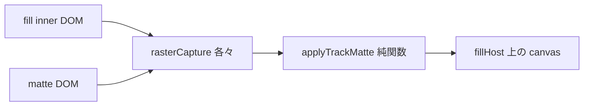

# トラックマット: Text マットで Solid 全体透明 — 修整計画（Opus Handback 反映）

## 一行結論

**現状マットは no-op（効いていない）。**  
原版の「全体透明」は foreignObject-in-SVG-mask。応急の `mix-blend-mode: destination-in` は **CSS では不正値**（Porter-Duff は canvas / feComposite 専用）で computed=`normal` → マット無効＝Solid 全表示。verify は false-green。

**正準（Opus 推奨・本 plan 固定）**: preview / export とも **canvas `applyTrackMatte`（純関数）**。ペア sig メモ化で静的マットは再ラスタしない。

Handback 全文: [RG-20260704-04](.cursor/delegations/handoffs/RG-20260704-04.md)

---

## Opus 確定 findings

| ID | 内容 | 確度 |
|----|------|------|
| H1 | SVG mask 内 foreignObject の HTML(text) を Chromium がマスクに描かない → 空マスク → 塗り全透明 | 高 |
| H2 | `mix-blend-mode: destination-in` は不正 CSS → no-op。現状は「全透明」が「マット無効」に化けただけ | 高 |
| H3 | `getComputedStyle==="normal"` はブレンド未適用の証拠（計測ミスではない） | 高 |
| H4 | Chromium に live DOM↔DOM alpha matte 経路は無い（mask/clip-path は画像系、`element()` 非対応） | 高 |
| H5 | 正準は canvas `applyTrackMatte` 一本。INV-2 は純関数共有で自動 | 推奨固定 |

**却下**: SVG mask+foreignObject / destination-in CSS / preview=CSS・export=canvas の二経路。

---

## 推奨アーキテクチャ

- 毎フレーム or **ペア sig 変化時**: fill / matte を既存 `rasterCapture` でラスタ → `applyTrackMatte` → fillHost に blit。
- マット源は通常合成から除外（現行 `isTrackMatteSource` 維持）。
- export は合成済み canvas をキャプチャ（二重適用しない）。

---

## 実装ステップ

1. **ユーザー確認**: §5.4f prose の正準を「canvas `applyTrackMatte`」に更新してよいか（§5 型・INV 不変）。
2. `trackMatteDom.ts` — destination-in 撤去、canvas ホストヘルパ。
3. `DomRenderer.ts` — raster → applyTrackMatte → blit + sig メモ化。
4. `exportComposite.ts` — 合成済み canvas キャプチャ、二重適用防止。
5. `trackMatteApply.ts` — 正準維持（premultiplied 確認）。
6. `verify-track-matte.mjs` — getImageData カバレッジ（>0% かつ <~40% for text）、グリフ内外、preview/export parity。
7. unit 追加 + `build:player` + progress。

---

## 受け入れ条件

| ID | 条件 |
|----|------|
| A1 | text alpha: 塗り不透明画素が塗り矩形の **>0 かつ <~40%** |
| A2 | グリフ内=塗り色、グリフ外（塗り矩形内）=透明 |
| A3 | solid マット: 不透明 bbox ≈ マット矩形 |
| A4 | alphaInverted は相補 |
| A5 | preview ↔ export 平均差 < ~2/255 または coverage ±2% |
| A6 | クリア後は通常兄弟表示 |
| A7 | `npm test` + `tsc` + `build:player` |

---

## 着手条件

- [x] ユーザー「続けて」で実装承認
- [x] canvas `applyTrackMatte` 正準実装・verify PASS（2026-07-04）
