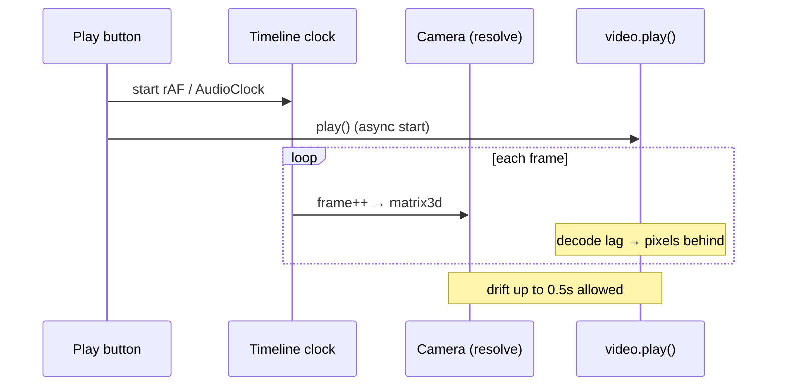

# 映像 × カメラベイク再生同期プラン

## 一行結論

**スクラブ経路は触らず**、再生開始時に映像を現フレームへハード同期してからクロックを起動し、再生中は映像が遅れたら **タイムライン（＝カメラ）を止めて待つ**。これで「モーションが早すぎる」ズレを消し、旧 HW の seek 連鎖スタッタ（対策 A）も壊さない。

## 症状と真因

| 観測 | 意味 |
|------|------|
| 編集中（スクラブ）は比較的合う | scrub = `playbackMode: false` → pause + フレーム中央 seek（決定論） |
| 再生するとカメラ／ベイク動きが映像より速い | カメラ transform は `resolve(frame)`（タイムライン時計）、映像ピクセルは `<video>.play()`（メディア時計） |
| ズレが「大きすぎる」ことがある | 再生中 drift 矯正は `PLAYBACK_RESYNC_THRESHOLD_SEC = 0.5s`（≈15f@30fps）まで seek しない（旧 HW スタッタ対策 A） |

モーショントラックは **映像フレーム列からカメラキーをベイク**する。再生時にタイムラインだけが進むと、カメラは「正しいフレームのポーズ」を先に表示し、映像ピクセルは遅れる → **モーションが早すぎる**ように見える。



## 非目標（スコープ外）

| やらない | 理由 |
|----------|------|
| scrub / export の seek 方針変更 | レスポンスと INV-2 を壊す |
| 再生中の毎フレーム `currentTime` seek（閾値を 3f に戻す等） | 旧 HW seek 連鎖スタッタが再発 |
| ベイク精度・SfM / Walk ソルバ変更 | 別軸（本バグは preview 時計） |
| video proxy / RAM Preview 拡張 | 別タスク |
| §5 型 / INV / `project.json` 変更 | 不要 |

## 推奨経路（固定）

**経路 H（Hold timeline to video）** = Play-start barrier + 再生中 timeline hold。

| フェーズ | 挙動 |
|----------|------|
| **Scrub / 停止** | 現行どおり（変更なし） |
| **Play 押下** | (1) 全マウント video を現 `targetSec` へ force seek + data ready 待ち（上限 `PLAY_GATE_TIMEOUT_MS`）(2) `previewVideoPlayback=true` で 1 回 render（`play()` 発火）(3) **その後** rAF / AudioClock 起動 |
| **再生中** | タイムラインが映像より **先**に進もうとしたら frame を進めない（hold）。映像が追いついたら再開。映像が先（稀）は現行の大閾値 resync のみ |
| **Pause** | 現行どおり pause + scrub seek |

### 却下した案

| 案 | 却下理由 |
|----|----------|
| **B: video-led clock（rVFC で frame 逆算）** | AudioClock マスターとの統合が重い。本症状は「カメラが先」なので hold で足りる |
| **T: 再生中 resync 閾値を締める** | 対策 A を部分的に巻き戻し、旧 HW でガクつき再発 |
| **S: seek で映像をタイムラインに追従** | 同上（seek 連鎖） |
| **R: playbackRate で追いつき** | 内蔵音声ピッチ変化・ブラウザ差。複雑さに見合わない |

## 影響経路（implementation-loop Phase 2）

| 経路 | 変更 |
|------|------|
| **preview 再生** | Play gate 強化 + hold ロジック（本命） |
| **preview scrub** | **変更なし** |
| **HTML bundle player** | Play-start barrier を同型適用（hold は Preview 優先、bundle は barrier のみでも可 → 下記） |
| **export / resolve / bake** | **変更なし**（INV-2 非干渉） |
| **store / タイムライン UI** | frame 進行が hold で一時停止するだけ（`setFrame` 頻度が落ちる） |

`npm run build:player` **必須**（`src/runtime` 変更時。hold を runtime に置く場合）。

## 設計詳細

### 1. Play-start barrier（必須）

現状の問題:

- `areMountedVideosPrimed` が true だと **prime をスキップ**して即 `startClock`
- primed キャッシュは「過去にそのフレームで decode できた」記録であり、**いま `video.currentTime` が一致している保証ではない**（再生停止直後・プール再利用後など）
- clock が先に走り、`play()` の実提示が遅れると開幕からカメラ先行

修正（**同一 async 関数内で順序固定** — `setPreviewRenderOptions` 用の別 `useEffect` に頼らない。React effect 順序レースを避ける）:

```ts
// PreviewPanel isPlaying effect（概念）
async function startPlaybackSynced(): Promise<void> {
  const renderer = rendererRef.current;
  if (renderer) {
    // キャッシュヒットでも実要素を現フレームへ再確認（force）
    await renderer.syncMountedVideosForPlay(cfg.fps, PLAY_GATE_TIMEOUT_MS);
  }
  if (cancelled) return;
  // previewVideoPlayback を先に立てて 1 フレーム描画 → play() 発火してから clock
  renderer?.setPreviewRenderOptions({
    previewVideoPlayback: true,
    holdLastRaster: !editingLive,
  });
  // draft / best どちらでも「現 frame を 1 回描く」（play() 発火）
  await renderCurrentFrameOnce(frameRef.current);
  if (cancelled) return;
  startClock(); // rAF / AudioClock
}
```

既存の `setPreviewRenderOptions({ previewVideoPlayback: isPlaying && !editingLive })` effect は残してよいが、**開始順序の正本は上記 async**（effect は pause 時のフラグ下ろし用）。

新規 API（`DomRenderer`）:

```ts
/** Play 直前: 全 video を dataset target へ seek+ready（primed キャッシュを信用しない）。 */
async syncMountedVideosForPlay(fps: number, timeoutMs?: number): Promise<boolean>
```

実装: `primeMountedVideos` と同型だが **`peekVideoPrimed` / primedKeys をバイパス**し、毎回 `primeVideoElement`（scrub seek + data ready）を実行。成功時のみ primed を更新。

**レスポンス非破壊**: scrub 中は呼ばない。Play 押下時のみ・上限 500ms。

### 2. 再生中 timeline hold（必須・preview）

**逆写像は使わない。** 既存 `dataset.mafterTargetSec`（タイムラインが要求したソース時刻）と `video.currentTime` の差だけで判定する（DomRenderer が毎フレーム既に書いている）。

純関数（`src/runtime/playbackVideoSync.ts` 新規）:

```ts
/** タイムライン要求時刻に対し映像が maxLeadSec 超遅れているか。 */
export function isVideoBehindTimeline(
  targetSec: number,
  currentTimeSec: number,
  maxLeadSec: number,
): boolean {
  return currentTimeSec < targetSec - maxLeadSec;
}

/**
 * マウント video のいずれかがタイムラインより遅れているなら true（hold）。
 * samples 空 = video 無し = hold しない。
 */
export function shouldHoldTimelineForVideos(
  samples: ReadonlyArray<{ targetSec: number; currentTimeSec: number }>,
  maxLeadSec: number,
): boolean
```

既定 `maxLeadSec = 0`（映像より 1 フレームでも先に進まない）。半フレーム余裕が必要なら `0.5/fps`。

複数 video: **1 本でも遅れれば hold**（カメラがどの映像より先に行かない）。

配線:

| クロック | 変更点 |
|----------|--------|
| `runPreviewPlaybackLoop` / `runPreviewFrameClock` | オプション `shouldHold?: () => boolean`。`true` の間は `currentFrame` を進めず `onFrameChange` もしない。wall-clock の `lastRafMs` は通常どおり消費（解放時にフレームジャンプしない） |
| `PreviewAudioClock` | **hold 中は `originFrame` / `originCtxTime` を現在値へ再ベース**しないと、解放時に `originFrame + elapsed*fps` が一気に跳ねる。加えて **hold 中は `AudioContext.suspend()`、解除で `resume()` + origin 再ベース**（音だけ先行しない） |
| `BundlePlayer` | Phase 1 は **barrier のみ**。hold は Preview で検証後に同型移植（完了条件に「bundle hold」は含めない） |

`DomRenderer` 読み取り API:

```ts
/** playback hold 用: 各 video の dataset.mafterTargetSec と currentTime */
sampleMountedVideoClocks(): Array<{ targetSec: number; currentTimeSec: number }>
```

追加 dataset（hostInPoint / trimStart）は **不要**（`mafterTargetSec` で足りる）。

### 3. 既存対策 A との共存

| 経路 | seek 挙動 |
|------|-----------|
| scrub | 現行（半フレーム閾値・seek 畳み込み） |
| playback drift seek | **現行のまま 0.5s**（映像をタイムラインに引っ張らない） |
| playback hold | **タイムラインを映像に合わせる**（seek しない） |

hold は seek を増やさないので、旧 HW の「映像 plane ガクつき」対策を壊さない。

## 受け入れ条件（測定可能）

| ID | 条件 | 判定 |
|----|------|------|
| A1 | `shouldHoldTimelineForVideos` / `isVideoBehindTimeline` の真偽表 unit（遅れ→hold、追いつき→解放、空 samples→false） | `npm test` playbackVideoSync |
| A2 | Play 開始時 `syncMountedVideosForPlay` が primed キャッシュを無視して prime を呼ぶ | unit（videoWarmupCache バイパス） |
| A3 | 既存 `videoElementSync.test.ts`（moderate drift 非 seek / large drift resync / forceSeek）全 PASS | `npm test` |
| A4 | scrub 経路のテスト・verify 無回帰 | `verify-video-import.mjs`（あれば edges） |
| A5 | `npm run build:player` 成功（runtime 変更時） | exit 0 |
| A6 | hold 中に rAF clock が frame を進めないこと（mock `shouldHold`） | unit on previewPlaybackLoop |
| A7 | AudioClock: hold→解放後に frame が wall-time 分ジャンプしない（origin 再ベース） | unit or 小さな fake clock test |

## 実装順序

1. `playbackVideoSync.ts` + unit tests（A1）
2. `DomRenderer.syncMountedVideosForPlay` + `sampleMountedVideoClocks` + dataset 記録
3. `PreviewPanel` play effect: barrier → render → clock。clock に hold 配線
4. `PreviewAudioClock` に hold（音声あり経路）
5. `BundlePlayer`: barrier のみ（`syncMountedVideosForPlay` に置換）
6. §11.4 散文 1 段落 + `build:player` + 回帰テスト + `progress.md`

## リスクと緩和

| リスク | 緩和 |
|--------|------|
| 音声ありで hold 中に音だけ進む | hold 中 `AudioContext.suspend()`、解除で `resume()` + `originFrame`/`originCtxTime` 再ベース |
| hold 解放時に frame が跳ねる | rAF: `lastRafMs` を通常消費。AudioClock: hold 中・解除時に origin 再ベース（A7） |
| hold で再生が「カクつく」 | 映像が実時間で進めば hold は発火しない。decode が追いついているマシンでは無変化 |
| Play が最大 500ms 遅延 | 既存 play gate と同上限。warm-up 済みなら seek は no-op で即返る |
| 複数 video で 1 本の遅延に全体が引きずられる | 意図どおり |
| `editingLive` 中は `previewVideoPlayback=false` | hold / barrier は通常再生（`!editingLive`）のみ。編集オーバーレイ中は現行どおり |

## ファイル一覧

| ファイル | 変更 |
|----------|------|
| `src/runtime/playbackVideoSync.ts` | **新規** 純関数 |
| `test/playbackVideoSync.test.ts` | **新規** |
| `src/runtime/DomRenderer.ts` | `syncMountedVideosForPlay` / `sampleMountedVideoClocks` / dataset |
| `src/runtime/videoElementSync.ts` | 変更最小（必要なら `primeVideoElement` の force フラグのみ） |
| `src/editor/panels/PreviewPanel.tsx` | play barrier + hold 配線 |
| `src/editor/previewPlaybackLoop.ts` | `getMaxFrame` clamp |
| `src/editor/previewAudioClock.ts` | 同上 |
| `src/player/BundlePlayer.ts` | barrier を `syncMountedVideosForPlay` に |
| `doc/mafter-effect-spec.md` | §11.4 散文のみ |
| `progress.md` | 末尾追記 |

## progress.md

実装完了後、末尾に日付・担当（Cursor）で追記。
