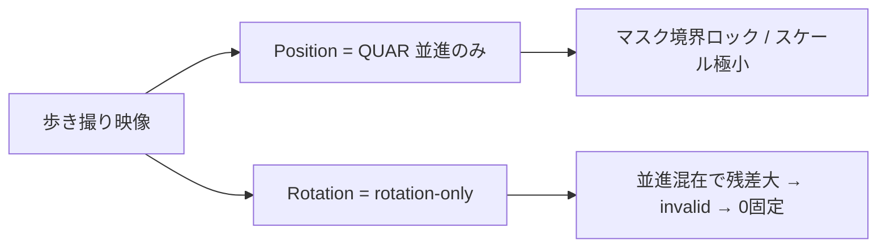
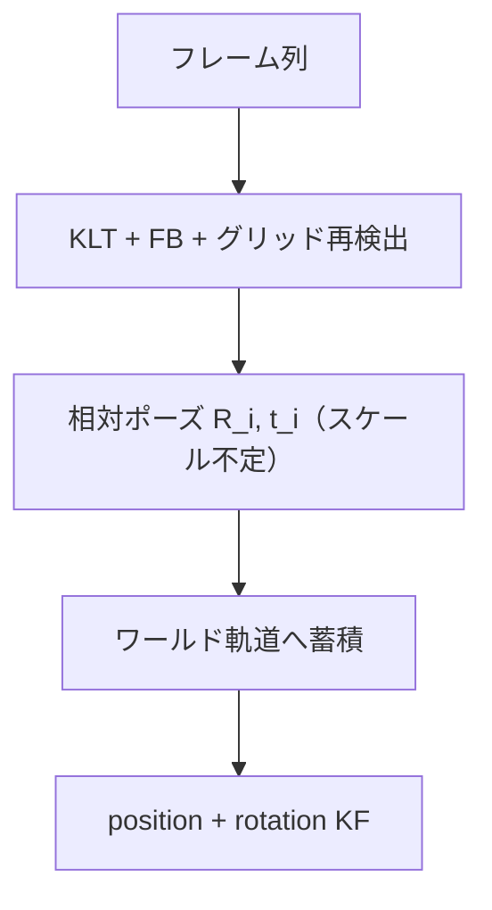

# Motion Track — 前進＋揺れ＋チルト対応計画

**再現**: Comp 27（`mafter-project (17).zip`）— 住宅街を歩き、揺れ、最後に見上げる。人間には動きが明らかだが、現行は position≈ノイズ・rotation=identity。

## なぜ今の設計では無理か



| 経路 | 前提 | Comp 27 で起きること |
|------|------|----------------------|
| **Position (QUAR)** | 静的シーンの並進方向 | 方向は取れても **非メトリックスケールが極小**。境界エッジにロックすると「高信頼ゼロ並進」 |
| **Rotation** | **その場回転のみ**（ノーダルパン） | 前進パララックスが残差になり **全フレーム invalid** → identity ホールド |
| **Both** | 上記を独立実行 | 両方弱い結果を足すだけ。相互作用なし |

人間が見る「前進・揺れ・上がる」は **1 本の 6DoF 軌道**（R と t が同時）。分離 VO では原理的に取りこぼす。

## 目標軌道（Comp 27）

| 区間 | 期待 |
|------|------|
| 前半〜中盤 | `position` が前進方向（主に −z or 規約上の前進軸）に単調に伸びる |
| 全体 | 手持ちの小揺れが position/rotation に低振幅で乗る（ガタつきすぎない） |
| 終盤 | `rotation.x`（pitch）が上向きに変化（例: 累積 ≥ 10°） |

## フェーズ分割

### Phase 2a — 並進を「見える」ようにする（依存追加なし・短期）

**目的**: 既存 QUAR の方向信号を、UI 上意味のある変位にする。チルトはまだ弱い。

1. **Auto-scale（推奨既定 ON）**
   - ベイク前に valid フレームの相対変位を集め、支配軸の range が `comp.height * autoScaleTarget`（既定 0.15）になるよう `userScale` を自動決定
   - 手動スライダーは「追加倍率」として残す（`effectiveScale = autoScale * userScale`）
2. **「動いているのに推定ゼロ」ゲート**
   - フレーム間の median optical flow（既に OpenCV worker がある）が閾値超なのに QUAR 変位 range が極小 → status 警告「並進が弱すぎます。全体マスクかスケールを確認」
3. **既定 full 維持**（Comp 27 修正済み）。背景優先は人混み専用のまま

**受け入れ（2a）**
- Comp 27・full・auto-scale: position 支配軸 range ≥ `0.1 * comp.height`（1080 なら ≥108px）
- 旧結果（range≈0.1px）の 100 倍以上

**限界**: チルトはまだ rotation-only のまま。Both でも終盤 pitch は弱い可能性。

---

### Phase 2b — 相対ポーズ（R+t）経路（本命・中期）

**目的**: フレーム間で **回転と並進を同時推定**し、蓄積して Camera/Null にベイク。Comp 27 の前進＋チルトの本丸。



**実装方針（推奨順）**

| 案 | 内容 | 工数 | 備考 |
|----|------|------|------|
| **B1** | OpenCV.js **カスタムビルド**（`findEssentialMat` / `recoverPose` 有効）を `public/motion-track/opencv-calib/` に vendoring | M | Apache-2.0。既存 KLT worker と同居 |
| **B2** | 純 TS/WASM で 5-point or 8-point + RANSAC + cheirality | L | 依存ゼロだが実装・検証コスト大 |
| **B3** | QUAR `Tracker6DoFHandle` 再評価 | — | 既に inert 実測済み。**今は不採用** |

**推奨: B1**

パイプライン詳細:

1. 既存 `rotationTrackWorker` の特徴トラックを共有（FB-LK・再検出）
2. 対応点 → `findEssentialMat` → `recoverPose` → `(R, t)`（t は単位ベクトル）
3. スケール: 連続フレーム間の t を、QUAR 並進ノルム or median flow でスケール結合（単眼の不定性は残る → auto-scale で UI 補正）
4. 累積: `T_world(i) = T_world(i-1) * T_rel(i)`、回転は四元数積、位置は累積平行移動
5. Mafter 座標変換（既存 `coordConvert` を拡張: 行列/四元数入力）
6. UI: 新モード **「6DoF（実験）」** または Both をこの経路に置き換え（旧 rotation-only は「その場回転」として残す）

**受け入れ（2b / Comp 27）**

- position 支配軸 range ≥ `0.1 * height`（auto-scale 後）
- 終盤 30 フレームで `max(|rotation.x|)` ≥ 10°（チルト）
- validRatio（相対ポーズ成功）≥ 0.5
- 手持ち揺れ: フレーム間ジャンプがスロープ制限内（既存 interp 流用）

---

### Phase 2c — 区間分類（任意・品質向上）

- 各フレームで rotation-only 残差 vs essential 残差を比較
- ドリー支配 → t を信頼、R は弱く平滑
- 回転支配（その場パン）→ 既存 rotation-only を優先
- 揺れ: 高周波を position/rotation に低通（ベイク前 median）

---

## UI 案

| モード | 用途 |
|--------|------|
| Position | 現行 QUAR + **auto-scale**（2a） |
| Rotation（その場） | 現行 rotation-only（三脚パン専用と明記） |
| **Walk / 6DoF** | 2b の R+t 蓄積（Comp 27 向け本命） |
| Both | 廃止 or Walk のエイリアス |

ラベル例: `Walk（前進・揺れ・見回し）`

## やらないこと

- resolve() 内ライブトラッキング
- GPL（AlvaAR）
- QUAR 6DoF に再依存（inert 実測済み）
- §5 / INV 変更（KF は既存 AnimatedProp）
- 「完璧なメトリックスケール」（単眼では不可。auto-scale + 手動倍率で十分）

## 実装順序（推奨）

```
2a（1–2 日）→ Comp 27 で前進が「見える」ことを確認
2b（数日）→ essential 経路でチルトも乗る
2c（任意）→ 区間分類で揺れを整える
```

## 検証

- 単体: essential 蓄積の符号・Euler、auto-scale 純関数
- 実機: `for-debug-data/_pj17` Comp 27 を Playwright で Track → KF range / pitch を機械判定
- 回帰: 合成パン（既存 verify-motion-track）・人混みは「背景優先」明示時のみ

## 期待値（正直）

| フェーズ後 | Comp 27 |
|------------|---------|
| 今 | 前進もチルトもほぼ無反応 |
| 2a 後 | **前進は見える**（スケール付き）。チルトは弱い |
| 2b 後 | **前進＋終盤の見上げ**が Camera に乗る。揺れはラフ |
| AE 3D Tracker 級 | Phase 2 COLMAP import（別路線） |
