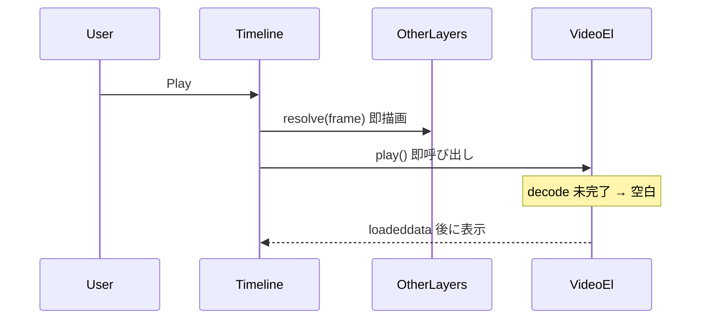

# 動画レイヤー事前 warm-up 実装計画

## 背景・真因

- **ファイル読込**は済んでいる: [`ImageAssetCache.loadFromProject`](src/runtime/imageAssetCache.ts) が blob URL 化済み。
- **デコード済みフレーム**は未保証: preview/bundle では [`waitForVideoFrame`](src/runtime/videoElementSync.ts) を使わず、`preload="auto"` + `play()` 任せ（[issue doc](doc/issue/video-preview-playback-stutter-old-hardware.md) L28）。
- 再生開始時、text/solid/image は `resolve(frame)` で即描画されるが、`<video>` は decode/present 待ちで **数フレーム〜数百 ms 空白**が出うる。
- 音声は [`audioBufferCache.ts`](src/editor/audioBufferCache.ts) + [`PreviewPanel` L621-634](src/editor/panels/PreviewPanel.tsx) で事前 decode 済み。**動画に同等機構がない**。



## 設計方針

| 原則 | 内容 |
|------|------|
| **音声と同型** | assetId キーの ready 状態 + inflight 去重。編集 idle 中に前倒し |
| **既存 `<video>` を再利用** | hidden プールは作らない（デコーダ二重化を避ける） |
| **再生ループは軽量維持** | 毎フレーム `waitForVideoFrame` は **preview でも使わない** |
| **条件付き play gate** | warm-up 済みなら Play 遅延ゼロ。未完了時のみ短時間 await（上限 ~500ms） |
| **INV-2** | export (`exportStep` + rVFC 待ち) は **一切変更しない** |

## 変更ファイル

### 1. [`src/runtime/videoElementSync.ts`](src/runtime/videoElementSync.ts)

`waitForVideoFrame` の step 1（seek/decode 待ち）を抽出し、preview 専用 API を追加:

```ts
/** preview warm-up: loadeddata まで待つ（rVFC present 待ちはしない） */
export async function primeVideoElement(
  video: HTMLVideoElement,
  targetSec: number,
  fps: number,
  timeoutMs?: number,
): Promise<boolean>
```

- 内部: `syncVideoElementTime(..., { playbackMode: false })` で scrub 同型 seek → `loadeddata` / `seeked` を poll（既存 loop を共通化）
- `readyState >= HAVE_CURRENT_DATA && videoWidth > 0` で成功判定

[`DomRenderer.ts`](src/runtime/DomRenderer.ts) の video 更新時、preview でも target 時刻を DOM に記録（warm-up 用）:

```ts
video.dataset.mafterTargetSec = String(t);  // export 専用 attr とは別
```

### 2. 新規 [`src/runtime/videoWarmupCache.ts`](src/runtime/videoWarmupCache.ts)

[`audioBufferCache.ts`](src/editor/audioBufferCache.ts) を模倣:

| API | 役割 |
|-----|------|
| `peekVideoPrimed(assetId, targetSec, fps)` | 同期: この時刻帯は primed 済みか |
| `primeVideoAtUrl(assetId, url, targetSec, fps)` | hidden ではなく **呼び出し側が渡した `<video>`** を prime し状態を記録 |
| `ensureVideosPrimed(items, getVideoForObjectId)` | 複数レイヤーを並列 prime（inflight 去重） |
| `evictVideoPrimed(assetId)` | Footage 削除時に状態破棄 |

- primed キー: `assetId + "@" + round(targetSec * fps)`（フレーム粒度）
- 成功時のみ Set に追加。失敗は best-effort（再生時に再試行）

### 3. [`src/runtime/DomRenderer.ts`](src/runtime/DomRenderer.ts)

preview/bundle 共通ヘルパ:

```ts
/** マウント済み video 要素を列挙（data-object-id 親 div 配下） */
forEachVideoElement(cb: (video: HTMLVideoElement, objectId: string) => void): void

/** 現在 DOM 上の video を一括 prime（preview/bundle 用） */
async primeMountedVideos(fps: number, timeoutMs?: number): Promise<boolean>
```

- `forEachVideoElement` は `entries` の `dataset.objectId` + `children` 内 `HTMLVideoElement` を走査
- `primeMountedVideos` は各 video の `dataset.mafterTargetSec` を読んで `primeVideoElement` を呼ぶ

### 4. [`src/editor/panels/PreviewPanel.tsx`](src/editor/panels/PreviewPanel.tsx)

**A. idle warm-up**（音声 preload の直下に追加）:

```ts
// comp 内 video レイヤー: blob URL 取得後、requestIdleCallback で prime
useEffect(() => {
  // comp.objects から type==="video" を列挙
  // imageCache 読込完了 + renderFrame 後（renderTick 依存）
  // requestIdleCallback(() => renderer.primeMountedVideos(fps))
}, [project, comp, renderTick, ...]);
```

- 対象: **編集中 comp の enabled video レイヤーのみ**（プロジェクト全体は対象外）
- inPoint 外のレイヤーは現在 frame に応じた targetSec（表示中フレーム）で prime

**B. 条件付き play gate**（`isPlaying` effect 内、rAF/AudioClock 開始前）:

```ts
if (!allPrimedAtCurrentFrame) {
  await renderer.primeMountedVideos(fps, PLAY_GATE_TIMEOUT_MS); // 例: 500ms
}
// 既存 clock.start() / startRafClock() へ
```

- warm-up 済みなら **追加遅延なし**
- ユーザー操作をブロックしないよう、タイムアウト後は best-effort で再生開始

**C. Footage 削除連携**: [`store.ts`](src/editor/store.ts) の `removeAsset` で `evictVideoPrimed(assetId)` を呼ぶ（`evictAudioBuffer` と同位置）

### 5. [`src/player/BundlePlayer.ts`](src/player/BundlePlayer.ts)

[`start()`](src/player/BundlePlayer.ts) L107-134 の **初回 `renderFrame` 後・`play()` 前**に:

```ts
await this.renderer.primeMountedVideos(this.manifest.fps);
// その後 audioClock.play / this.play()
```

- blob 化（`loadVideoBlobsFromUrls`）は既存のまま
- 自動再生開始前に 1 回だけ prime

### 6. spec 追記（§5 / INV 非変更）

[`doc/mafter-effect-spec.md`](doc/mafter-effect-spec.md) **§11.4** に §11.5 音声プリロードと対になる散文を 1 段落追加:

- preview / bundle player は編集中 comp の video レイヤーを **idle 中に `<video>` seek + decode まで warm-up**
- export は従来どおり `waitForVideoFrame`（決定論）
- warm-up 失敗は best-effort（再生開始時に再試行）

### 7. テスト

| ファイル | 内容 |
|---------|------|
| [`test/videoElementSync.test.ts`](test/videoElementSync.test.ts) | `primeVideoElement` の mock テスト（loadeddata 待ち・タイムアウト・既 ready スキップ） |
| 新規 `test/videoWarmupCache.test.ts` | `peekVideoPrimed` / inflight 去重 / `evictVideoPrimed` |
| 新規 or 拡張 `verify-video-import.mjs` | Play 直後 3 フレーム以内に `video.readyState >= 2` かつ `videoWidth > 0` を assert |

### 8. ビルド・回帰

- `src/runtime/**` 変更のため **`npm run build:player` 必須**
- 回帰: `npm test` / `verify-video-import*.mjs` / `verify-bundle-video-playback.mjs` / `videoElementSync.test.ts`
- [`progress.md`](progress.md) 末尾に追記

## 意図的にやらないこと（スコープ外）

- **video proxy（対策 D）**: decode 負荷削減は別タスク
- **毎フレーム rVFC 同期（対策 B）**: 旧 HW スタッタ対策と独立
- **export 経路の変更**: INV-2 export 側は現状維持
- **ネスト precomp 専用ロジック**: `forEachVideoElement` が nested 内 video も拾えば自動対応。不足なら follow-up

## リスクと緩和

| リスク | 緩和 |
|--------|------|
| 初回 comp 表示で idle decode が重い | `requestIdleCallback` + comp スコープ限定 |
| Play gate が体感遅い | warm-up 済みなら gate スキップ。未完了時も 500ms cap |
| bundle 自動再生開始が遅れる | 1 回限り・音声 prepare と並行可能なら先に blob 済み |

## 実装順序

1. `primeVideoElement` + unit test
2. `videoWarmupCache.ts` + unit test
3. `DomRenderer.forEachVideoElement` / `primeMountedVideos` + `dataset.mafterTargetSec`
4. `PreviewPanel` idle warm-up + play gate
5. `BundlePlayer.start()` への組み込み
6. spec §11.4 追記 → `build:player` → verify スクリプト → progress 更新
