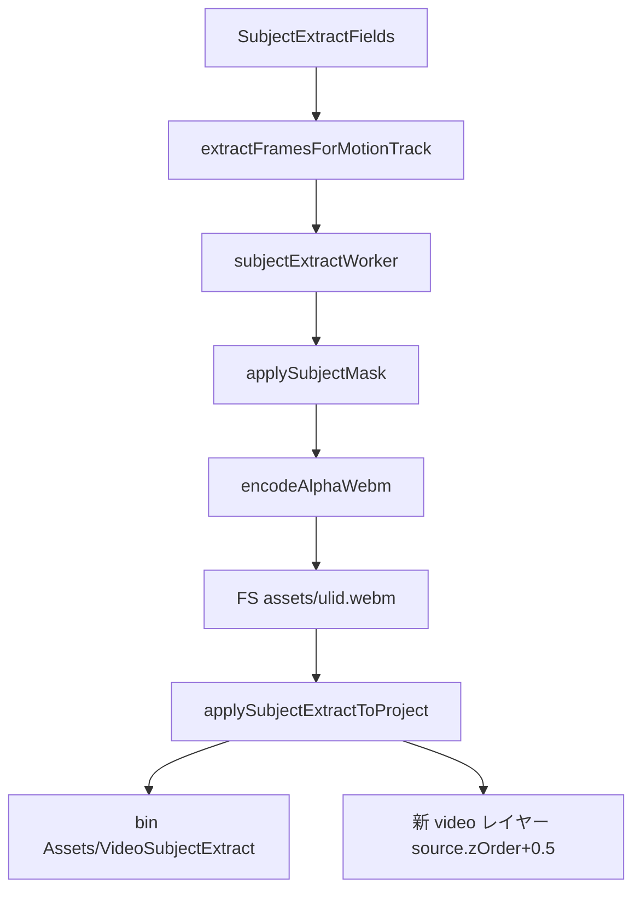

# 動画オブジェクト抽出（Subject Extract）— 実装プラン

## ゴール

- **入力**: 選択中 video レイヤーのソース動画
- **操作**: ビデオプロパティにプルダウン（対象種別）+ Extract ボタン
- **出力**:
  - **切り抜き WebM を新 video レイヤー**として comp に追加（元レイヤーはそのまま）
  - **新レイヤーは元 video レイヤーの直上**（描画順・タイムライン上ともに「ソースの 1 枚上」）
  - **生成アセットは Project パネル `Assets/VideoSubjectExtract` フォルダ**に格納
- **技術**: v1 = MediaPipe Selfie Segmentation（人物）。OpenCV はフレーム抽出の再利用のみ

---

## ユーザー指定（2026-07-05 反映）

| 項目 | 方針 |
|------|------|
| **レイヤー配置** | comp 最上段ではなく、**ソース video レイヤーの直上**（`zOrder = source.zOrder + 0.5`。既存 Duplicate と同型） |
| **アセット配置** | Project Bin **`Assets` → `VideoSubjectExtract`**（ネスト）。無ければ作成、あれば再利用 |
| **FS 実体** | 従来どおり `assets/<ulid>.webm`（物理パスは bin 名と独立。zip/INV-4 互換） |

Pre-render（[`preRender.ts`](src/editor/preRender.ts)）は「comp 最上段 + `pre-rendered` bin」と異なる。**Subject Extract は Pre-render パターンを流用せず**、配置・bin 専用の純関数を新設する。

---

## アーキテクチャ



**INV 境界**: editor-only 解析 → ベイク済み WebM を通常 video として再生。`resolve()` / `player.js` 非変更。

---

## レイヤー配置（詳細）

[`commands.ts`](src/editor/commands.ts) の Duplicate と同じ **fractional zOrder**:

```ts
const newZOrder = sourceLayer.zOrder + 0.5;
```

- `inPoint` / `outPoint` / `transform` / `parent` / `opacity` はソースレイヤーからコピー
- レイヤー名: `{source.name} — Person`（将来は対象種別に応じて suffix 変更）
- 新レイヤーを選択状態にする（Extract 完了後 UX）
- **Pre-render との差**: Pre-render は `Math.max(...zOrder) + 1` で最上段。Subject Extract は **ソース直上のみ**

---

## アセット配置（詳細）

`src/editor/subjectExtract/subjectExtractBin.ts`（新規）:

```ts
export const ASSETS_BIN_NAME = "Assets";
export const SUBJECT_EXTRACT_BIN_NAME = "VideoSubjectExtract";

/** Assets → VideoSubjectExtract を返す。無ければ親子とも作成。 */
export function ensureSubjectExtractBin(
  project: Project,
  newAssetsBinId: string,
  newExtractBinId: string,
): { project: Project; binId: string }
```

- `asset.binId` = `VideoSubjectExtract` bin の id
- `appendTreeEntry(project, { kind: "asset", id }, binId)` で treeOrder 更新
- 物理ファイル: [`DIR_ASSETS`](src/core/paths.ts) = `assets/<ulid>.webm`（変更なし）
- meta 例: `{ width, height, duration, mime: "video/webm", hasAlpha: true, extractedFrom: "<sourceAssetId>" }`

Project パネル上の表示パス: **`Assets/VideoSubjectExtract`**（§20.5 nested bin）

---

## UI

[`VideoComponentFields.tsx`](src/editor/panels/VideoComponentFields.tsx) に `SubjectExtractFields` 折りたたみ:

| コントロール | 内容 |
|-------------|------|
| Subject プルダウン | v1: `Person` のみ（+ 未選択） |
| Sample interval | Motion Track 同型 |
| Extract | 実行 / Abort / 進捗 |

プルダウン選択はセッション UI のみ（`project.json` 非永続）。

---

## 処理パイプライン

1. **フレーム抽出** — [`frameExtractor.ts`](src/editor/motionTrack/frameExtractor.ts) 再利用
2. **セグメンテーション** — `subjectExtractWorker.ts` + MediaPipe（`public/subject-extract/mediapipe/`）
3. **マスク合成** — `maskComposite.ts` 純関数（`fill.alpha *= mask/255`）
4. **WebM alpha エンコード** — `encodeAlphaWebm.ts`（editor 専用。`exporter.ts` 本体は触らない）
5. **プロジェクト反映** — `applySubjectExtractToProject.ts`（bin + レイヤー + asset）

---

## Spec 更新

[`doc/mafter-effect-spec.md`](doc/mafter-effect-spec.md) **§16.2 Subject Extract from footage**:

- editor-only 境界
- 出力: WebM VP9 alpha
- **レイヤー: ソース video 直上（zOrder + 0.5）**
- **アセット bin: `Assets/VideoSubjectExtract`**
- alpha 動画のブラウザ制約（§16 既述）

§5 / INV 変更なし。

---

## 依存

MediaPipe Tasks Vision Selfie Segmentation ~6MB vendored（Apache-2.0、`PROVENANCE.md`）。

---

## フェーズ

### Phase 1（本 plan）

- Person / MediaPipe / WebM alpha / 直上レイヤー / `Assets/VideoSubjectExtract`

### Phase 2（将来）

- OpenCV DNN 矩形検出（Car 等）
- Motion Track マスク連携
- 複数人物選択

---

## 触るファイル

| ファイル | 変更 |
|---------|------|
| `src/editor/subjectExtract/*.ts` | worker / composite / encode / apply / **subjectExtractBin** |
| `src/editor/panels/SubjectExtractFields.tsx` | UI |
| [`VideoComponentFields.tsx`](src/editor/panels/VideoComponentFields.tsx) | 配線 |
| `public/subject-extract/mediapipe/` | vendored ML |
| [`doc/mafter-effect-spec.md`](doc/mafter-effect-spec.md) | §16.2 |
| `test/subjectExtract*.test.ts` | 純関数（mask / zOrder / bin ensure） |

**非変更**: `resolve.ts`, `DomRenderer.ts`, `exporter.ts` 本体, `player.js`

---

## 受け入れ条件

1. Extract 後、**新レイヤーがソース video の 1 枚上**にあり、チェッカー上で人物のみ表示
2. Project パネルで成果物が **`Assets/VideoSubjectExtract`** に表示
3. 元 video レイヤー・アセットは不変
4. Undo 1 回で巻き戻し
5. 既存 test / export / motion-track verify 無回帰

---

## 実装順序

1. spec §16.2
2. `subjectExtractBin` + `maskComposite` + テスト
3. MediaPipe worker スパイク
4. encode + apply（zOrder 直上・bin 配線）
5. UI
6. verify + progress
