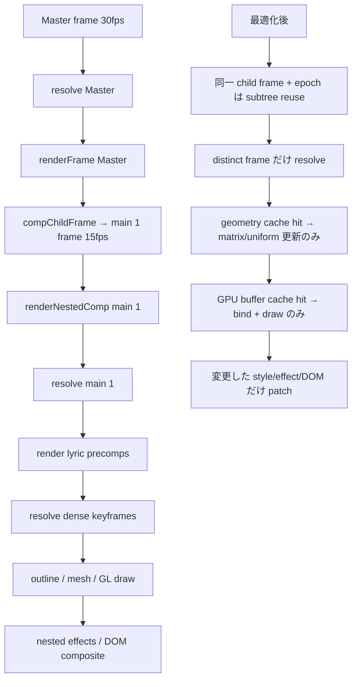

# Master に重量級 precomp を読み込んだときの非破壊高速化 PLAN

> 作成日: 2026-07-19  
> 対象: `Downloads` 内の最大 Mafter project にある `Master → main 1 → 複数 lyric comp` 構成  
> ステータス: **実装前 PLAN（コード変更なし）**  
> 前提: 見た目・時間マッピング・保存形式・export 結果を変えない。フレームスキップや自動品質低下は行わない。

---

## 0. 結論

現状の最優先課題は「precomp を読み込むこと」自体ではなく、同じ child frame に対して次の仕事を繰り返していることにある。

1. ネスト階層ごとの `resolve()` と全オブジェクト走査
2. nested wrapper / component / effect DOM の同値更新
3. 3D text のアウトライン抽出・nonzero 正規化
4. 共有 WebGL canvas 上での mesh VBO 再アップロード

対象プロジェクトは `Master=30fps`、`main 1=15fps` なので、`Master` の 531 フレームから参照される `main 1` は **266 child frame しかない**。現在は残り **265 回（49.9%）も同一 child frame を再解決・再描画**する。さらに、`main 1` の重い区間では最大 45 枚の 3D-extrude text が同時に見え、変形だけが変わるのに、毎回アウトライン処理と GL buffer upload が走りうる。

推奨する実装順は次のとおり。

1. 実プロジェクト由来の再現 fixture と計測ゲートを固定する
2. キーフレーム探索を線形走査から完全同値の二分探索へ変える
3. 3D text の「準備済み geometry」を cache し、アウトライン処理を transform-only frame から除く
4. 共有 GL canvas に複数 mesh の GPU buffer を常駐させ、mesh 切替時の再 upload を除く
5. nested DOM/effect をトップレベル相当の差分更新へ進める
6. resource epoch を備えた後に、同一 child frame の subtree render を安全に省略する
7. 再計測で残った箇所だけを追加最適化する

この順なら、各段階を単独で rollback でき、出力を変える最適化を混ぜずに進められる。

---

## 1. 非破壊の定義

本 PLAN における「非破壊」は、単に `project.json` を書き換えないという意味ではない。以下をすべて満たすことを完了条件とする。

### 1.1 変更してはならないもの

- `§5` データスキーマ
- `project.json` の直列化形式
- INV-1〜INV-6
- `compChildFrame()` の時間マッピング
- オブジェクトの z-order、blend、effect 順、調整レイヤーの作用範囲
- preview / mp4 / webm / PNG / bundle の scene 解決値
- 3D mesh、投影行列、法線、色、ライティングの数式
- Caching 設定、Draft/Best、Proxy のユーザー既定値

### 1.2 採用しない高速化

- distinct frame の間引き
- playback 中だけ effect や 3D layer を落とす処理
- 自動的な解像度低下
- `main 1` を暗黙に pre-render 動画へ置換する処理
- `resolve()` と別の意味論を持つ第二の frame evaluator
- preview だけに近似式を入れ、export は旧式のままにする二重実装
- cache hit を正しさの前提にする設計（miss は必ず従来経路へ戻る）

### 1.3 許可する高速化

- 同じ入力に対する純計算結果の memoization
- 同じ DOM/style/filter 値の再代入抑制
- 同一 child frame・同一 resource epoch の再評価抑制
- CPU mesh と GPU buffer の有界 cache
- 線形探索を意味論同一の二分探索に置換
- DOM node / WebGL context / decoded media element の再利用

すべての cache は runtime 内部のみで、保存しない。cache の不整合が疑われる場合は「誤った hit」ではなく「miss に倒して従来描画」を選ぶ。

---

## 2. 調査対象と確認済み事実

### 2.1 対象ファイル

2026-07-19 時点で `C:\Users\resis\Downloads` の最大 ZIP を調査した。

| 項目 | 値 |
|---|---:|
| ZIP | `mafter-project (12).purini remix (1).zip` |
| ZIP サイズ | 589,976,631 bytes |
| `project.json` | 7,832,665 bytes |
| comp 数 | 13 |
| `Master` | 2430 frames / 30fps / 3 objects |
| `main 1` | 1245 frames / 15fps / 15 objects |
| `Master` 内の `main 1` 使用区間 | parent frame `[0, 531)` |
| 上記区間の child frame | 0〜265、266 unique frames |
| 同一 child frame の重複呼び出し | 265 / 531 = 49.9% |

巨大な 546MB MKV や 63MB WAV は import/cold-load コストには影響するが、`Master → main 1` の live render で特徴的な重さは、次の scene 構造にも由来する。

### 2.2 `main 1` の構造

`main 1` は以下を同時に扱う。

- `music and screen` precomp
- `bg` precomp
- 3つの重量級 lyric precomp
- chroma split / gradient map / mosaic / blur の通常・調整 effect
- video layer
- 15fps comp を 30fps の `Master` から参照する fps 変換

重量級 lyric comp の keyframe 数は次のとおり。

| child comp | objects | animated props | keyframes |
|---|---:|---:|---:|
| `1-ああゆらり-` | 17 | 34 | 5,484 |
| `2-もう一人じゃないよって` | 26 | 57 | 9,033 |
| `3-なんてことないんだ` | 19 | 44 | 8,629 |
| 合計 | 62 | 135 | **23,146** |

大部分は各文字レイヤーの position / rotation / scale をほぼ毎 frame 持つ dense keyframe である。

`main 1` frame 188〜204 では、3つの lyric precomp 内で **45 枚の 3D-extrude text が同時に可視**になる。これが現時点で最も重要な hot interval である。

### 2.3 現行コードで確認できる重複仕事

以下は wall-clock profiler 前でもコードとデータから存在を断定できる。ただし全体時間に占める比率は Phase 0 で実測する。

| 確認事項 | 現行箇所 | 状態 |
|---|---|---|
| child comp は呼び出しごとに `resolve()` | `DomRenderer.renderNestedComp()` | 同じ child frame でも再実行 |
| nested container の `cssText` | `DomRenderer.ts` | 毎 frame 全書き込み |
| nested wrapper の `cssText` | `DomRenderer.ts` | wrapper は再利用済みだが style は毎 frame 全書き込み |
| component element の再利用 | `nestedElReuse` | `text` / `video` / `comp` のみ。その他は再生成 |
| DOM 順序 | `container.appendChild(div)` | 全 object を毎 frame 再 append |
| nested live effect | `applyNestedLiveEffects()` | effect chain / SVG defs を毎 frame 再構築 |
| keyframe 区間探索 | `interpolate.ts::findSegment()` | 先頭から線形走査 O(K) |
| 3D outline | `applyGeom3DText()` | `textToOutlineGlyphs()` が mesh cache lookup より前 |
| CPU mesh cache | `geom3dMeshCache.ts` | mesh は cache するが outline/layout/normalization は毎回実行 |
| GL mesh buffer | `geom3dGl.ts` | canvas ごとに `lastMesh` 1件のみ |
| 共有 canvas 上の mesh 切替 | `geom3dGl.ts` | mesh が変わるたび positions/normals/indices を `bufferData()` |
| precomp content hash | `precompRasterService.getRaster()` | raster 対象では request ごとに再計算。今回の主 live path では優先度低 |

### 2.4 現行の良い部分（壊さない）

- トップレベル `DomRenderer.entries` は objectId reconcile 済み
- nested wrapper も `nestedWrappers` により objectId reconcile 済み
- `text` / `video` / 再帰 comp の element は持ち越し済み
- 3D canvas は precomp container 単位で共有され、GL context 枯渇対策済み
- `resolve()` は preview/export/bundle で共有され、INV-2 の基礎になっている
- `geom3dMeshCache` は CPU mesh の再生成を一部回避している
- `compFrameCapture` と `exportComposite` は export の決定論経路を担っている

従って「レンダラを全面的に作り直す」必要はない。既存の正しい骨格に、同値計算と同値更新を避ける層を追加する。

---

## 3. 現状と目標パイプライン



重要なのは、最適化後も `resolve()` と `renderNestedComp()` を正準経路として残すこと。cache はこれらの結果・適用状態を再利用するだけで、別の scene 解決意味論を作らない。

---

## 4. 成功条件

### 4.1 正しさ

代表 frame を最低限次で固定する。

| `main 1` child frame | 対応する `Master` parent frame pair の例 | 意味 |
|---:|---:|---|
| 0 | 0 | cold start |
| 84 | 167 / 168 | lyric 1 + lyric 2 進入 |
| 145 | 289 / 290 | lyric 3 進入 |
| 188〜204 | 対応する各 duplicate pair | 3D text 45枚の peak |
| 220 | 439 / 440 | lyric 4 / blur / mosaic 重複区間 |
| 224 | 447 / 448 | lyric 1 離脱境界付近 |
| 265 | 529 / 530 | `main 1` 終端付近 |

各 phase で以下を満たす。

- standalone `main 1` と `Master` 内 `main 1` の child-frame 対応が不変
- 同じ child frame を単独描画した画像と連続再生中に到達した画像が一致
- preview screenshot / PNG export / bundle screenshot の効果シグネチャ一致
- GL canvas 数・host 割当・z-order が不変
- video/audio の進行、seek、mute、loop が不変
- adjustment / mosaic / blur / gradient / blend の作用範囲が不変
- project import → save → zip export のバイト正準性に影響なし

ピクセル比較の基準は、可能な経路では `maxAbs=0`。ブラウザ codec や screenshot の不可避差がある経路でも `≤2/255` を上限とし、差分領域を目視する。性能改善を理由に許容差を広げない。

### 4.2 性能

Phase 0 baseline と同じ端末・Chrome・DPR・解像度で比較する。

Primary goal:

- `Master` の hot interval（child frame 188〜204）を Caching OFF / 1920×1080 / DPR=1 で warm playback し、`render callback` p95 を **33.3ms 以下**にする

Secondary goals:

- baseline 比で hot interval の p50 を **50%以上短縮**
- p95 を **35%以上短縮**
- duplicate child frame の renderer CPU 時間を distinct child frame の **20%以下**、または **2ms以下**
- steady-state の outline normalization 回数を「可視3Dレイヤー×frame」から「geometry key の miss 回数」へ落とす
- steady-state の GL `bufferData` を原則 0 にする（新 mesh / eviction / context restore 時のみ許可）
- `Too many active WebGL contexts` / context lost = 0
- 30秒 playback の heap / GPU resource が単調増加しない

性能テストは wall-clock だけで CI 合否にしない。CI では操作回数（resolve count、outline build count、`bufferData` count、SVG defs replacement count）を固定し、wall-clock は同一マシンの benchmark report として扱う。

---

## 5. Phase 0 — spec と計測ゲートを先に固定

### 5.1 spec 追記

実装前に `doc/mafter-effect-spec.md` の §23.3 配下へ、散文のみで「nested live render の非破壊 cache 契約」を追加する。§5 / INV / 直列化は変更しない。

記載する契約:

- cache key は runtime-only
- distinct child frame は必ず正準 `resolve()` を通る
- 同一 child frame の再利用は comp identity、render mode、resource epoch が一致するときだけ
- resource ready、font load、asset replacement、quality、render scale、export mode、context restore で invalidation
- cache miss / 不明状態は旧経路へ fallback
- preview/export/bundle の scene 値は共通 `resolve()` のまま

### 5.2 小型 fixture

外部 590MB ZIP を CI 依存にしない。次の2 fixtureを用意する。

1. **local-real fixture**: 元 ZIP から `project.json` と font を使い、巨大 media を小型の決定論素材へ置換したローカル専用 fixture。ID、comp、keyframe、in/out、fps、effect は維持する。
2. **repo synthetic fixture**: `Master(30fps) → main1(15fps) → lyric1/2/3`、45枚の同時 3D text、23k相当の dense keyframe、mosaic/blur/adjustment を再現する小型生成 fixture。

fixture 生成は元 ZIP を変更せず、新規一時/生成物として扱う。巨大 media やユーザー固有音源をリポジトリへコミットしない。

### 5.3 baseline script

新規 `bench-master-nested-live.mjs` を恒久 benchmark とする。少なくとも以下を収集する。

- frame total
- root `resolve`
- nested `resolve`（compId / depth 別）
- nested reconcile / style write / append count
- effect chain build / SVG defs replacement
- `textToOutlineGlyphs` / `normalizeRingsNonzero` / mesh build
- WebGL `bufferData` / `drawElements` / context count
- layout read (`offsetWidth/offsetHeight`) 回数
- long task count / duration
- JS heap の開始・終了・peak

計測ケース:

- `main 1` standalone scrub
- `Master` scrub
- `Master` 30fps playback
- 同じ child frame を指す parent frame pair
- cold first frame / warm steady-state
- Caching ON / OFF（主判定は OFF）
- preview / PNG capture / bundle

### 5.4 Phase 0 DoD

- baseline JSON と短い分析 markdown を `doc/cloudplan/` に保存
- hot interval と上位5 stack を CDP CPU profile で確定
- 本 PLAN の仮説順位を実測値で更新
- 以降の各 phase を feature flag 単位で A/B できる状態にする

---

## 6. Phase 1 — keyframe 区間探索を完全同値の二分探索へ

### 6.1 目的

`interpolate.ts::findSegment()` は keyframe を先頭から走査する。対象データは1 propあたり 178〜218 keyframe の dense track を多数持つため、frame 後半ほど比較回数が増える。

### 6.2 実装

- `findSegment()` を lower-bound 型の二分探索に置換する
- first/last clamp、区間端、hold、easing の計算式は変えない
- duplicate frame が存在しても旧線形探索と同じ pair を選ぶよう、旧実装を reference として残した test helper で照合する
- API は `sampleScalar` / `sampleVec3` / `sampleRgba` / `sampleAny` のまま

### 6.3 テスト

- 0/1/2/N keyframes
- frame が first/last の前後・一致
- duplicate frame
- negative/large frame
- scalar / Vec3 / RGBA / step型
- easing 全種
- seeded property fuzz で旧線形実装と数万ケース完全一致

### 6.4 rollback

単一 helper の差分なので、改善が計測不能または parity failure なら即 revert。ほかの phase と混ぜない。

---

## 7. Phase 2 — 3D text の Prepared Geometry Cache

### 7.1 真因

現状の `applyGeom3DText()` は次の順で動く。

1. `parseTextProps`
2. `textToOutlineGlyphs`
3. `font.getPath`
4. curve flatten
5. `normalizeRingsNonzero`
6. mesh key 作成
7. `getCachedMesh`

つまり CPU mesh cache が hit しても、1〜5 は毎 frame 実行する。対象プロジェクトは文字形状が静的で transform だけが dense animation なので、これは純粋な重複仕事である。

### 7.2 実装

`geom3dMeshCache` を「meshだけ」でなく、描画に必要な静的 geometry 全体を持つ `PreparedGeom3DText` cache へ拡張する。

```ts
interface PreparedGeom3DText {
  mesh: MeshData;
  minX: number;
  minY: number;
  width: number;
  height: number;
}
```

cache key に含めるもの:

- 実際の `Font` identity
- text
- size / tracking / leading / align / box size
- curve quality
- depth / bevel size / bevel style / bevel segments

含めないもの:

- world transform
- camera matrix / fov
- color
- light direction / ambient
- opacity

これらは geometry を変えず、従来どおり毎 frame uniform / matrix として更新する。

重要事項:

- cache lookup を `textToOutlineGlyphs()` より前へ移す
- miss builder は現行の outline → normalize → extrude をそのまま呼ぶ
- entry数固定ではなく推定 byte size を持つ有界 LRU とする
- project/font 切替、Font instance 差替えで誤 hit しない
- cache を無効化しても描画できる

### 7.3 テスト

- transform-only 100 frames で outline build = 1
- camera/light/color の変更では geometry hit
- text/font/size/tracking/curve/depth/bevel の変更では miss
- LRU eviction 後は正しく再 build
- cache ON/OFF の mesh typed array と PNG が完全一致
- `main 1` peak interval で normalization count が unique geometry 数まで下がる

---

## 8. Phase 3 — WebGL mesh buffer resident cache

### 8.1 真因

現在の `Geom3DGlState` は `lastMesh` を1つだけ持つ。共有 canvas に45文字を描くと、mesh A→B→C… と切り替わるたびに次が走る。

- positions `bufferData`
- normals `bufferData`
- indices `bufferData`

次 frame も描画順が同じなので、全 mesh が再 upload される。CPU mesh cache が効いていても GPU transfer は減らない。

### 8.2 実装

canvas/context ごとに `MeshData` identity を key とした GPU buffer bundle cache を持つ。

```ts
interface GpuMeshBuffers {
  position: WebGLBuffer;
  normal: WebGLBuffer;
  index: WebGLBuffer;
  indexCount: number;
  byteSize: number;
}
```

draw 時は:

1. cache hit → buffer bind + attrib pointer + draw
2. miss → 従来どおり upload → cache insert → draw
3. byte budget 超過 → LRU entry を `deleteBuffer` して eviction

ガード:

- shader、blend、depth test、clear、uniform、draw order は不変
- shared canvas の depth buffer 共有規則は不変
- context lost で全 entry を破棄し、restore 後は miss から再構築
- `releaseGeom3DGl()` が全 WebGLBuffer を明示解放
- CPU mesh cache eviction と GPU cache の寿命を混同しない
- budget は runtime-only。`project.json` に追加しない

### 8.3 テスト

- N mesh × M frames で `drawElements=N×M` は維持
- warm 後の `bufferData=0`
- geometry 変更時だけ新規 upload
- LRU eviction / context loss / dispose で `deleteBuffer`
- per-layer canvas と shared canvas の両方
- standalone と nested の PNG parity
- 30秒再生で GPU cache byte size が上限内

---

## 9. Phase 4 — nested DOM / effect の完全差分更新

### 9.1 目的

2026-07-16 の reconcile 化で wrapper div の identity は維持されるようになったが、wrapper の中身と effect 適用はトップレベルほど差分化されていない。本 phase では「wrapper再利用」から「entry状態の再利用」へ進める。

### 9.2 `NestedObjectEntry`

container ごとに次を保持する。

```ts
interface NestedObjectEntry {
  div: HTMLDivElement;
  children: HTMLElement[];
  childSig: string;
  effectSig: string;
  svgRoot: SVGSVGElement | null;
  lastTransform: string | null;
  lastOpacity: string | null;
  lastZ: string | null;
  lastBlend: BlendMode | null;
  mode: "content" | "adjustment";
}
```

`nestedWrappers` を消して別物を増やすのではなく、同じ container-local map を entry map へ発展させる。

### 9.3 子 element reconcile

- `obj.components.map(c => c.type).join("|")` を signature とする
- signature 不変なら全 component element を再利用
- signature 変更時だけ、型別 teardown → rebuild
- text/video/comp の現行 resource 持ち越しを維持
- image/solid/shape も通常 frame では再生成しない
- split/packed alpha、video pool、geom canvas の解放順を維持

### 9.4 style patch

次を「値が変化したときだけ」更新する。

- container width/height/background/isolation/perspective
- wrapper transform/opacity/zIndex
- adjustment width/height/background/pointerEvents
- blend mode

ただし adjustment↔content、matte mode、camera/perspective mode が変わった frame は last-value を無効化し、必ず全必要値を書き直す。

DOM 順序は毎 frame 全 `appendChild` せず、現在順と期待順が異なる node だけ `insertBefore` する。zOrder tie の id 順も維持する。

### 9.5 effect patch

現行 `applyNestedLiveEffects()` は SVG defs を毎 frame生成する。トップレベルの `applyEffects()` / `syncSvgFilters()` と同様に、次の2段階へ分ける。

1. effect chain の解決
2. DOM filter/defs の同期

注意: effect props が同じでも `ctx.frame` に依存する effect はあるため、単純に props signature だけで chain 解決を省略しない。

- chain は当面毎 frame 解決してよい
- 生成された CSS token / SVG primitive / region signature が同じなら DOM を触らない
- frame-independent が EffectDef metadata で証明できる effect だけ、後続 phase で chain 解決自体を memoize
- effect 0件、disabled、型変更時に古い `filter` / `backdrop-filter` / SVG root を明示クリア
- export の `__exportLayer` / `__nestedComposite` metadata は毎 frame正しい値を持つ

### 9.6 段階分割

- 4A: component element reconcile
- 4B: transform/opacity/container style patch
- 4C: DOM order minimal patch
- 4D: live effect SVG/filter sync

各 sub-phase を別 commit・別 benchmark にする。4D は adjustment/export 回帰面が広いため最後にする。

---

## 10. Phase 5 — 同一 child frame の subtree reuse

### 10.1 目的

`Master 30fps → main 1 15fps` では同じ child frame がほぼ2回ずつ要求される。Phase 4 までで entry と resource lifecycle を明示化した後、同一 frame の2回目を安全に no-op 化する。

### 10.2 container-local state

```ts
interface NestedRenderState {
  comp: TimelineComposition;
  childFrame: Frame;
  modeEpoch: number;
  resourceEpoch: number;
  evaluatorEpoch: number;
  completed: boolean;
}
```

skip 条件はすべて一致したときだけ。

- 同一 container
- 同一 child comp identity
- 同一 child frame
- 同一 render mode（preview/export、quality、renderScale、video mode等）
- 同一 font/image/resource ready epoch
- 同一 evaluator/timeline map epoch
- 前回 render が同期・非同期 work を含め正常完了
- context lost していない

### 10.3 skip 時にも必要な仕事

subtree DOM/GL を再描画しなくても、次は維持する。

- 親 comp layer 自身の transform / opacity / zIndex 更新（親 `applyObject` が担当）
- native playback 中 video の継続
- audio clock（DOM subtree render と分離済み）
- export capture が同じ preserve buffer / DOM を読める状態
- pending resource が ready になった場合の epoch invalidation

### 10.4 やってはいけない単純化

`childFrame === lastFrame` だけを見て return してはならない。初回 font load、image decode、video readiness、quality切替、effect mode、export mode、context restore を取りこぼすからである。

### 10.5 テスト

- 30→15fps の 531 parent frames で nested full render = 266
- duplicate frame でも parent transform animation は反映
- font ready / image ready / video metadata / context restore で再描画
- preview mode↔export mode で再描画
- scrub back、loop wrap、comp切替、project編集で stale reuse なし
- same precomp を2レイヤーに置いたとき container 間でstateを共有しない
- deep nest depth 2〜4
- sequential frame N と単独 frame N の画像一致

---

## 11. Phase 6 — 再計測後だけ行う条件付き最適化

以下は存在するコストだが、今回の main live path の主因と断定していない。Phase 1〜5 後の profile で上位に残った場合だけ実施する。

### 11.1 `resolve()` structural preparation

候補:

- object id map
- track matte pair
- merge input source set
- fade suppression の frame-independent 部分
- component/effect の animated/static descriptor

条件:

- `resolve()` を唯一の公開意味論として維持
- comp object の in-place mutation を監査し、安全な invalidation が証明できる
- cache ON/OFF の `ResolvedScene` deep equality を全 test で固定

不変性を証明できない場合は採用しない。

### 11.2 `compContentHash` memo

`precompRasterService.getRaster()` は request ごとに `compContentHash()` を呼ぶ。full displacement / processPixels を含む重量級 precomp では別の hot path になりうる。

- `configure()` 時または project identity 変更時に comp hash を一度計算
- descendant comp / asset 変更で親 hash を invalidation
- 今回の `main 1` live path では raster target でないため、Phase 0 で上位に出なければ後回し

### 11.3 layout read 削減

`offsetWidth/offsetHeight` が強制 layout の上位に残った場合のみ、既知 component bounds または前回 bounds を使う。ただし font/image ready で寸法が変わるため resource epoch と組み合わせる。推測値で filter region を狭めてはいけない。

### 11.4 AABB canvas crop

3D canvas を comp 全域から group AABB へ縮める案は、camera、moving bounds、effect capture、foreignObject export の座標変換が広く変わる。画を壊すリスクが高いため本 PLAN の core から除外する。Phase 1〜6 後も fill-rate が支配的であることを GPU trace が示した場合、別 PLAN と spec から始める。

---

## 12. 変更対象ファイル見込み

| Phase | 主ファイル | 役割 |
|---|---|---|
| 0 | `doc/mafter-effect-spec.md` | 非破壊 cache 契約の散文追記 |
| 0 | `bench-master-nested-live.mjs` | 実プロジェクト相当 benchmark |
| 1 | `src/runtime/interpolate.ts` | keyframe binary search |
| 2 | `src/runtime/geom3d/geom3dMeshCache.ts` | prepared geometry cache |
| 2 | `src/runtime/geom3d/geom3dDomApply.ts` | cache lookup を outline より前へ |
| 3 | `src/runtime/geom3d/geom3dGl.ts` | per-context GPU mesh buffer cache |
| 4 | `src/runtime/DomRenderer.ts` | nested entry / DOM / effect patch |
| 4 | effect DOM helper（既存から抽出） | top/nested の filter sync 共有 |
| 5 | `src/runtime/DomRenderer.ts` | nested render state / epoch guard |
| 5 | font/image/media cache | ready epoch の read-only expose（必要最小限） |
| 6 | `src/runtime/resolve.ts` | profileで必要な場合のみ |
| 6 | `src/editor/precompRasterService.ts` | hash memo（条件付き） |
| 全runtime phase | `public/player.js` | `npm run build:player` で再生成 |
| 全phase | `progress.md` | 完了・計測・残課題を記録 |

新規 helper を作る場合も、preview と bundle が同じ runtime helper を import する構造にする。

---

## 13. 検証マトリクス

### 13.1 自動テスト

- `npm run typecheck`
- `npm test`
- `npm run build:player`
- `test/playerBuildFreshness.test.ts`
- interpolation reference parity / fuzz
- prepared geometry cache hit/miss/eviction
- GPU buffer cache upload/bind/eviction/context-loss
- nested render invalidation matrix
- operation-count benchmark assertion

### 13.2 既存実機 verify

最低限:

- `verify-nested-reconcile.mjs`
- `verify-nested-geom3d.mjs`
- `verify-nested-geom3d-share.mjs`
- `verify-nested-geom3d-share-export.mjs`
- `verify-export-adjustment.mjs`
- `verify-blend-mode.mjs`
- `verify-track-matte.mjs`
- `verify-video-export.mjs`
- `verify-bundle-export.mjs`

実プロジェクト依存 verify が巨大ZIPで実行不能な環境では、Phase 0 の synthetic fixture を代替にする。ただし最終受け入れ前にユーザーの最大ZIPでも実行する。

### 13.3 経路

| 経路 | 必須確認 |
|---|---|
| Preview live | scrub / playback / loop / resource ready |
| RAM / precomp cache | cache miss→build→hit、緑線、Cache OFF復帰 |
| PNG | representative frames の pixel parity |
| mp4 / webm | frame順・video同期・effect欠落なし |
| HTML bundle | player.js freshness、3D/effect/video parity |
| deep nested capture | adjustment、3D、blend、camera context |

---

## 14. Rollout と rollback

### 14.1 feature flag

Phase 2〜5 は開発時のみ切替可能な非直列化 flag を用意して A/B する。例:

- `__mafterPreparedGeomCache`
- `__mafterGpuMeshCache`
- `__mafterNestedPatch`
- `__mafterNestedSameFrameReuse`

flag は project schema に追加しない。検証完了後、1つずつ既定 ON にし、旧経路は少なくとも1リリース分 fallback として残す。

### 14.2 commit 単位

- WP-0 benchmark/spec
- WP-1 interpolation
- WP-2 prepared geometry
- WP-3 GPU buffers
- WP-4A〜D nested patch
- WP-5 same-frame reuse

各 commit は単独で test/benchmark 可能にし、性能改善が無い、または parity が崩れた phase だけ revert できるようにする。

### 14.3 停止条件

次の場合は次 phase へ進まない。

- representative frame に pixel差が出た
- sequential N と isolated N が一致しない
- video/audio の時間対応が変わった
- GL/context/heap が単調増加する
- 既存 nested/export verify が赤になった
- Phase 単体で wall-clock 改善も operation count 改善も無い
- §5 / INV / 直列化変更が必要になった

最後のケースではユーザー承認を取り直し、別 PLAN に分ける。

---

## 15. 実装順チェックリスト

### Phase 0

- [ ] spec §23.3 に runtime-only cache 契約を先行追記
- [ ] local-real / synthetic fixture
- [ ] benchmark script と baseline JSON
- [ ] hot stack と操作回数を確定

### Phase 1

- [ ] `findSegment` の完全同値二分探索
- [ ] reference fuzz parity
- [ ] 実プロジェクト resolve 時間再計測

### Phase 2

- [ ] prepared geometry key を outline 前に計算
- [ ] bounded cache / eviction / font identity invalidation
- [ ] transform-only frame で outline build 1回
- [ ] nested/standalone PNG parity

### Phase 3

- [ ] per-context GPU buffer cache
- [ ] warm frame `bufferData=0`
- [ ] context loss / dispose / eviction
- [ ] shared canvas depth/order parity

### Phase 4

- [ ] nested component child reconcile
- [ ] style/container minimal patch
- [ ] DOM order minimal patch
- [ ] nested SVG/filter sync
- [ ] adjustment/matte/blend stale-state cleanup

### Phase 5

- [ ] resource/mode/evaluator epoch
- [ ] same child frame guard
- [ ] 531 parent calls → 266 full subtree renders
- [ ] media/loop/export invalidation

### Final

- [ ] typecheck / full test
- [ ] `npm run build:player`
- [ ] preview / PNG / mp4 / webm / bundle 横断 verify
- [ ] 最大ZIPで最終 benchmark
- [ ] p50/p95 / operation count / memory report
- [ ] `progress.md` 更新
- [ ] feature flag を段階的に既定 ON

---

## 16. 期待効果と優先順位

現時点の期待順位は次のとおり。Phase 0 で実測して入れ替える。

| 優先 | 施策 | 対象データに対する理由 | リスク |
|---:|---|---|---|
| 1 | Prepared Geometry Cache | 最大45枚の静的文字形状に毎frame outline/normalization | 低〜中 |
| 2 | GPU multi-mesh buffer cache | 共有canvasでmesh切替ごとに3 buffer upload | 中 |
| 3 | same child-frame reuse | Master区間の49.9%が重複 child frame | 中 |
| 4 | nested effect/DOM patch | main 1 の mosaic/blur/調整 SVGを毎frame同期 | 中〜高 |
| 5 | keyframe binary search | 23,146 dense keyframes、線形探索 | 低 |
| 6 | resolve structural plan / hash memo | profileで残った場合のみ | 高 |

Phase 1〜3 だけで 30fps 目標を満たす場合でも、Phase 4〜5 は「追加で必ず実装」ではない。再計測し、複雑性に見合う改善がある phase だけを採用する。これも非破壊性の一部である。

---

## 17. 最終的な完成像

完成後もユーザーから見える機能や保存データは変わらない。

- `Master` に `main 1` を置くだけでよい
- 15fps child の distinct frame はすべて正しく描く
- 30fps parent の重複 sample は既存 subtree を安全に再利用する
- 文字形状が変わらない frame は行列・uniform・draw だけで進む
- GPU mesh は context 内に有界常駐し、毎frame upload しない
- effect/DOM は値が変わった箇所だけ更新する
- resource load / edit / mode change は確実に invalidation する
- cache miss や context loss 時は従来描画へ戻る
- preview / export / bundle の見た目と時間対応は変わらない

この状態を、今回の最大プロジェクトと小型回帰 fixture の両方で数値・ピクセル・resource count により固定する。
