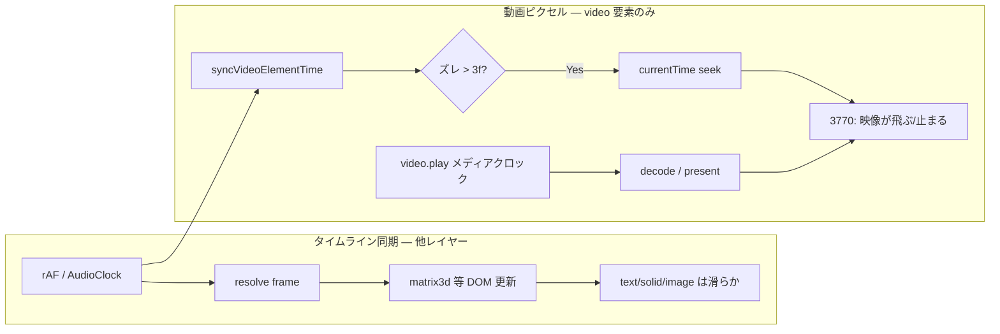

# Preview / Live HTML — 動画レイヤー再生スタッタ（旧 HW vs 新 HW）

> **対象**: エディタ Preview パネル・§11.7 HTML bundle player（`BundlePlayer`）における `component.type === "video"` の Footage レイヤー再生  
> **状態**: 2026-06-30 **対策 A 実装済み** — 再生中の drift seek を大閾値化（`PLAYBACK_RESYNC_THRESHOLD_SEC = 0.5s`）。proxy(D) / rVFC clock(B) は follow-up。詳細は下記「想定修正方針」参照。  
> **再現報告**: **i7-11xxx** では軽量。**i7-3770（Ivy Bridge）** では動画 Footage を含む comp を再生すると、**同じコンポジット内で動画レイヤーの映像だけがガクガク**する。**同時に表示されている text / solid / image 等の他レイヤーはスムーズ**（2D/3D 問わず）。動画 Footage を含まない comp は問題なし。

**関連 spec**: §11.2 preview / §11.7 bundle / §20 Footage / INV-2（preview ↔ export 同一 scene 解決値）  
**関連実装**: [PreviewPanel.tsx](../../src/editor/panels/PreviewPanel.tsx) / [previewPlaybackLoop.ts](../../src/editor/previewPlaybackLoop.ts) / [videoElementSync.ts](../../src/runtime/videoElementSync.ts) / [DomRenderer.ts](../../src/runtime/DomRenderer.ts) / [imageAssetCache.ts](../../src/runtime/imageAssetCache.ts) / [BundlePlayer.ts](../../src/player/BundlePlayer.ts)

**関連 issue**: [video-footage-export-sluggish.md](./video-footage-export-sluggish.md)（export 経路のもっさり・別軸）

**検証スクリプト**: `verify-video-import.mjs` / `verify-video-import-edges.mjs`（preview）、`verify-bundle-video-playback.mjs`（bundle）

---

## 背景（調査のきっかけ）

### Q1: プレビュー / live HTML が動画をロードしているとき、コード的に何をしているか

動画専用のローディング UI や待機ループは **ない**。次の 3 段で処理する。

| 段階 | エディタ Preview | HTML bundle（`BundlePlayer`） |
|------|------------------|-------------------------------|
| **1. キャッシュ** | `ImageAssetCache.loadFromProject` → IndexedDbFs からファイル全体を読み `decodeVideoEntry` で **blob URL** 化 | まず `registerProjectUrls`（HTTP 相対 URL）、続けて `loadVideoBlobsFromUrls` で動画のみ fetch → blob 化 |
| **2. DOM** | `DomRenderer.updateComponentEl("video")` で `<video src=blob:…>`、`muted` / `playsInline` / `preload="auto"` | 同じ `DomRenderer` 経路 |
| **3. 時刻同期** | `syncVideoElementTime`（scrub = seek、再生 = `play()`） | 同様（`previewVideoPlayback` フラグ） |

**preview / bundle では `waitForVideoFrame`（`loadeddata` / rVFC 待ち）を呼ばない**。decode 待ちはブラウザの `<video preload="auto">` + `play()` に任せる。厳密待ちは **export 専用**。

動画は画像と違い **プレビュー用 proxy 縮小がない**（常に原寸 blob）。

### Q2: 重くなるのはどの世代の CPU からか（コード上の閾値はない）

コードに「○世代から重い」という固定閾値はない。重さは **コーデックの HW decode 有無・解像度・comp 複雑さ・scrub か再生か** の組み合わせで決まる。

| 条件 | 体感が重くなりやすい目安 |
|------|------------------------|
| H.264 1080p・再生のみ・エフェクト少 | Core 2 世代（〜2009）以前 |
| HEVC / 4K | Skylake（2015）以前 |
| VP9 | 第 8 世代 Intel 以前 |
| AV1 | 2020 年以前 |
| scrub | 再生より 1〜2 世代新しめでも重い |

再生中は `video.play()` で **GPU / メディアエンジン** に decode を任せる設計。CPU 世代より **HW decode と seek コスト** の方が効きやすい。

---

## 症状（ユーザー報告・本 issue の焦点）

| 環境 | 挙動 |
|------|------|
| **i7-11xxx** | 動画 + 他レイヤー混在 comp の preview 再生は **軽量** |
| **i7-3770** | 動画 + 他レイヤー混在 comp で **動画の映像ピクセルだけガクガク**。**同じフレーム上の他レイヤー（text / solid / image / 3D transform 等）はスムーズに動く** |
| **i7-3770** | 動画 Footage を含まない comp は **問題なし** |

### 観測の意味（重要）

| 見え方 | 意味 |
|--------|------|
| **プレビュー全体が低 fps**（全レイヤーが一緒にカクつく） | **ではない**（ユーザー報告） |
| **動画 `<video>` の中身だけがガクガク**、兄弟レイヤーは滑らか | **これが本 issue の症状** |

→ タイムラインの frame 進行・`resolve()`・他レイヤーの `matrix3d` 更新は **3770 でも足りている**。ボトルネックは **`<video>` 要素の時刻同期・decode・present** に閉じている可能性が高い。

### 訂正（初版ドキュメントの誤解）

初版は「動画レイヤーがある comp 全体がスタッタ」と読める記述だったが、正しくは **同一コンポジット内で他レイヤーはスムーズ、動画 Footage の表示だけがガクガク** である。

---

## 現行実装の整理

### 再生ループ（Preview）

- **Draft 再生**: `runPreviewPlaybackLoop` — rAF で frame 進行 + `performPreviewRender` を直接呼ぶ。
- **Best / 非 Draft 再生**: `runPreviewFrameClock` — rAF で `setFrame` のみ。描画は React effect が `frame` 変化で `renderFrame` を実行。
- 音声あり: `PreviewAudioClock` がマスタークロック（decode は [audioBufferCache.ts](../../src/editor/audioBufferCache.ts) でプリロード）。

再生中は `PreviewPanel` が次を設定する。

```ts
renderer.setPreviewRenderOptions({
  holdLastRaster: isPlaying && !editingLive,
  previewVideoPlayback: isPlaying && !editingLive,
});
```

### 毎フレームの処理（動画レイヤーあり）

1. タイムライン `frame` を comp fps で進める（rAF / AudioClock）
2. `resolve(comp, frame)` → `DomRenderer.renderFrame`
3. 全オブジェクトの transform / DOM を in-place 更新
4. `flushRasterEffects()`（raster effect がある場合）
5. 動画レイヤーごとに `syncVideoElementTime(video, t, fps, { playbackMode: true })`

`t` の計算: `(hostFrame - hostInPoint) / fps + trimStart / fps`

### `syncVideoElementTime` 再生モード（`playbackMode: true`）

意図: 再生中は `video.play()` に任せ、**毎フレーム seek しない**。

実装:

1. `paused` なら seek（必要時）→ `play()`
2. 再生中は **ズレが 3 フレーム超**（30fps なら約 100ms）のときだけ `video.currentTime = targetSec`（= **seek**）
3. scrub / 停止時は pause + フレーム中央へ決定論 seek（INV-2 用）

```ts
// videoElementSync.ts（要約）
if (options.playbackMode) {
  if (video.paused) { /* seek + play() */ return; }
  if (Math.abs(video.currentTime - targetSec) > frameSec * 3) {
    video.currentTime = targetSec; // seek
  }
  return;
}
```

### 二重の時計（他レイヤーと動画で更新経路が分かれる）

| 対象 | 毎フレームの更新経路 | 見た目 |
|------|---------------------|--------|
| **text / solid / image 等** | `resolve(frame)` → `applyObject` → `matrix3d` / opacity を DOM に反映 | タイムライン fps に同期して **滑らか**（3770 でも可） |
| **動画 Footage** | 同上で **親 div の transform は毎フレーム更新**されるが、**ピクセル内容**は `<video>` のメディアクロック + `play()` で進む。さらに `syncVideoElementTime` がズレ時に `currentTime` seek | **映像だけ** メディアクロックと矯正 seek の影響を受け、**ガクガク** しうる |

| 時計 | 進め方 |
|------|--------|
| **タイムライン** | rAF / AudioClock が離散的に `frame` を進める |
| **動画ピクセル** | `video.play()` +（ズレ時）`currentTime` seek |

他レイヤーはタイムライン 1 本、動画ピクセルは別経路 — だから **同じ comp 内で他は滑らか・動画だけ荒い** という見え方になる。

---

## 真因候補（コードレビュー結論）

### 主因: 動画ピクセルだけが別クロック — 遅い HW での drift seek が映像をガクガクさせる



1. **他レイヤー**は毎フレーム `resolve(frame)` の結果で transform が更新される → タイムラインと一体で **滑らか**（3770 でもユーザー報告どおり）。
2. **動画のピクセル**は `<video>` が独自に decode/present。`syncVideoElementTime` がタイムラインの `targetSec` と `video.currentTime` を比較し、**ズレ > 3 フレームで seek**。
3. i7-3770 では seek 後のキーフレーム再 decode / present 復帰が遅い → **動画テクスチャだけ** が飛び・止まり・二重フレームに見える（**ガクガク**）。親 div の transform は他レイヤーと同様に滑らかなので、**周囲の text 等は問題なく動いて見える**。
4. i7-11xxx では seek が軽く、drift 矯正が目立たない。

この症状パターン（**同 comp 内で他レイヤー OK・動画だけ NG**）は、**コンポジット全体の fps 低下**より **`<video>` 要素固有の時刻同期** の説明と強く整合する。

### 副次要因（全体 fps ではなく映像品質を悪化）

| 要因 | 動画ピクセルへの影響 |
|------|---------------------|
| preview が rVFC で動画 present に同期していない | タイムライン更新と動画フレーム提示の beat がずれ、旧 HW でジャダーに見えやすい |
| 動画 fps ≠ comp fps | `play()` 実時間と comp 30fps の beat 不一致 |
| 原寸 decode（proxy なし） | 3770 iGPU の present 余裕が減り、動画 plane だけ落ちやすい |

### 増幅要因（動画 plane 固有）

| 要因 | 内容 |
|------|------|
| **HW メディアエンジン** | i7-3770（Ivy Bridge / HD 4000）: H.264 HW decode は可だが **seek 後の present 復帰**が遅い。HEVC/VP9/AV1 は非対応 or ソフト decode |
| **動画 proxy なし** | 画像は `proxyMaxDim` で縮小するが動画は原寸 blob のまま decode |
| **毎フレーム `syncVideoElementTime`** | 再生中も drift チェック → seek 発火のきっかけ（他レイヤーの transform 更新とは独立） |
| **bundle 経路** | 症状が同型なら `BundlePlayer` も要確認（[progress.md](../../progress.md) §11.7）。ただし本報告の焦点は **映像 plane のガクつき** |

### 本 issue で **主因ではない** と判断したもの

- **プレビュー全体の低 fps**（同 comp 内の他レイヤーが滑らかなら除外）
- `resolve()` + 非動画レイヤーの DOM 更新負荷（他レイヤーが滑らかなら除外）
- export 経路の毎フレーム決定論 seek（別 issue）
- 動画ロード中の `waitForVideoFrame`（preview では未使用）

---

## 解決可能か

### ソフトウェアでかなり改善可能（推奨）

| 優先 | 対策 | 内容 | 期待効果 |
|------|------|------|----------|
| **A** | 再生中 sync 停止 | `playbackMode` 中は `play()` 開始・ループ境界・pause 時のみ合わせ、**再生中の毎フレーム `syncVideoElementTime` を呼ばない** | seek 連鎖の根本対策 |
| **B** | 動画主導 clock | `requestVideoFrameCallback` 等で frame を逆算し、タイムラインを動画に追従 | 二重時計の解消 |
| **C** | 動画レイヤー更新の間引き | 再生中・transform 不変なら video 要素の sync をスキップ | メインスレッド負荷減 |
| **D** | プレビュー用 video proxy | decode 解像度を下げる（画像 proxy と同型） | 旧 iGPU の decode 負荷減 |
| **E** | RAM Preview 活用 | 動画 comp で静止部分をキャッシュ overlay、動画だけ live（§28 既存） | 既存インフラの活用 |

**A + B** だけでも i7-3770 の「**同 comp 内で動画映像だけガクガク**」は大幅改善見込み。他レイヤーの滑らかさは既に足りているため、修正は **`<video>` 同期経路に閉じる** べき。preview 経路のみの変更なら export の決定論 seek（INV-2 export 側）は別維持可能。

### 完全には無理な部分（トレードオフ）

| 内容 | 理由 |
|------|------|
| 3770 で 4K HEVC を原寸・フル品質で 11 世代並み | HW decode 限界。proxy / トランスコードが必要 |
| scrub を 3770 で再生並みに軽く | 本質的に seek 依存。既存の seek 畳み込みは scrub 専用で、再生より重くなりがち |
| `<video>` + CSS `matrix3d` 合成の上限 | ブラウザ / iGPU 任せ。解像度・レイヤー数に天井あり |

**結論**: **解決可能**（設計変更で seek 連鎖を断つ）。ただし **3770 を 11 世代と同等にする** のではなく、**古い HW でも seek を踏まないプレビュー設計** への変更が必要。

---

## 想定修正方針（未実装）

1. **`videoElementSync.ts`**: ✅ **実装済み**。再生中（`playbackMode` かつ `!video.paused`）の drift 矯正 seek を `frameSec * 3`（≈100ms）→ `PLAYBACK_RESYNC_THRESHOLD_SEC = 0.5s`（≈15 frames @30fps）へ大幅緩和。通常の decode lag drift はネイティブ `play()` の追従に任せ、本当の不連続（ループ復帰・大ジャンプ）でのみ `currentTime` 代入。pause→play 開始・scrub・export(`exportStep`) 経路は不変（INV-2 維持）。preview と HTML bundle は同一 `syncVideoElementTime` を通るため両方に適用（`public/player.js` 再ビルド済み）。
2. **`DomRenderer.ts`**: `previewVideoPlayback` 中は video コンポーネントの `updateComponentEl` をスキップする fast path（transform だけ更新等）を検討。
3. **（任意）`imageAssetCache.ts`**: プレビュー専用 `videoProxyMaxDim`（§5 非変更・メタのみ / ランタイム cache オプション）。
4. **`BundlePlayer.ts`**: Preview と同一方針を bundle 再生に適用（[progress.md](../../progress.md) Next #0 と統合可）。

**INV-2**: preview の「見た目」は維持。export は従来どおり `exportStep` + `waitForVideoFrame`（変更しない）。

---

## 検証・切り分け手順

### ユーザー側（i7-3770）

1. 動画 + text 等が **同時に動く comp** で再生し、**text は滑らか・動画だけガクガク** を目視確認。
2. Chrome DevTools → **Performance** で記録。
3. **`video` 要素の `seeking` / `currentTime` 代入** の頻度を確認（他レイヤーの `transform` 更新は一定間隔で続いているはず）。
4. **seek が秒に数回以上** かつ他レイヤーは滑らかなら、動画ピクセル固有の drift seek 仮説を支持。

### 開発側

| 手順 | 内容 |
|------|------|
| Before/after | 3770 実機で **動画 + 他レイヤー混在 comp** を再生。動画映像のガクつきが減るか、他レイヤーの滑らかさを壊さないかを確認 |
| 回帰 | `verify-video-import-edges.mjs`（preview scrub + 再生）、`npm test` の `videoElementSync.test.ts` |
| 11 世代 | 同 comp で無回帰（A/B で既存のスムーズさを壊さない） |
| bundle | `verify-bundle-video-playback.mjs` |

### テスト追加案

- `playbackMode` 中に drift < 大閾値では `currentTime` を書き換えないことを固定する unit test
- （任意）playwright で `video.seeking` イベント回数の上限アサート

---

## 参照ログ（調査セッション 2026-06-30）

- プレビュー / live HTML の動画ロード: `ImageAssetCache` → `DomRenderer` `<video>` → `syncVideoElementTime`（ロード待ちはブラウザ任せ）
- CPU 世代: 固定閾値なし。HW decode / seek / scrub が支配的
- **症状（訂正 2026-06-30）**: i7-3770 で **動画 + 他レイヤー混在 comp** を再生すると、**動画映像だけガクガク・同 comp 内の他レイヤーはスムーズ**。comp 全体の低 fps ではない
- 真因候補: 他レイヤーはタイムライン同期、動画ピクセルだけ `<video>` メディアクロック + drift seek → Ivy Bridge で seek/present が目立つ
