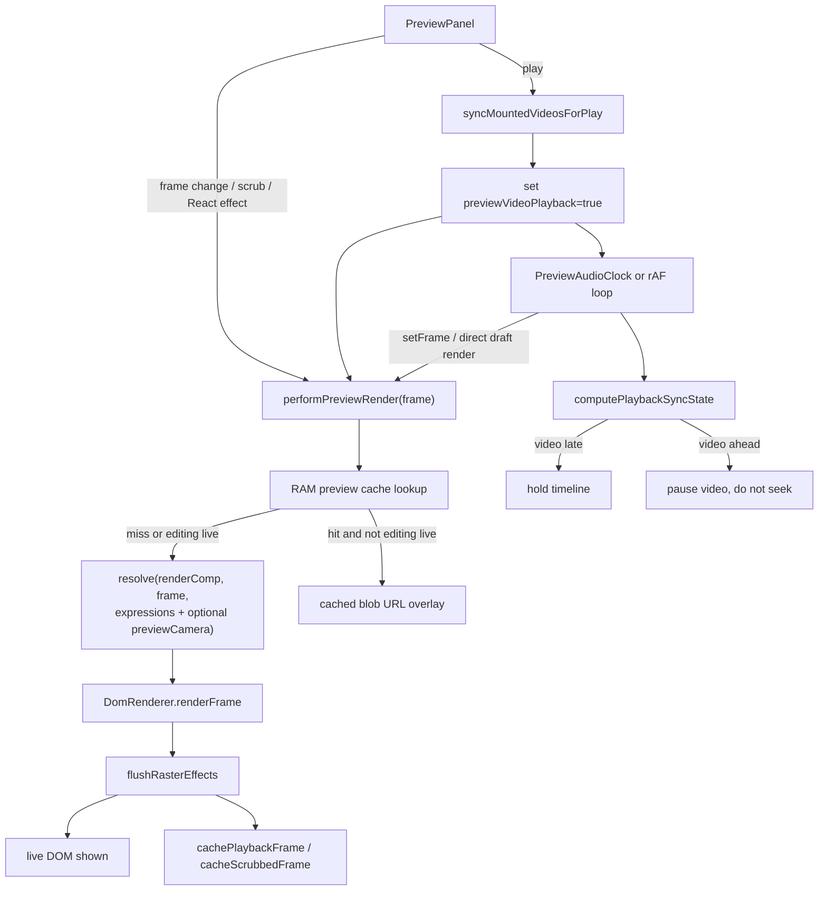
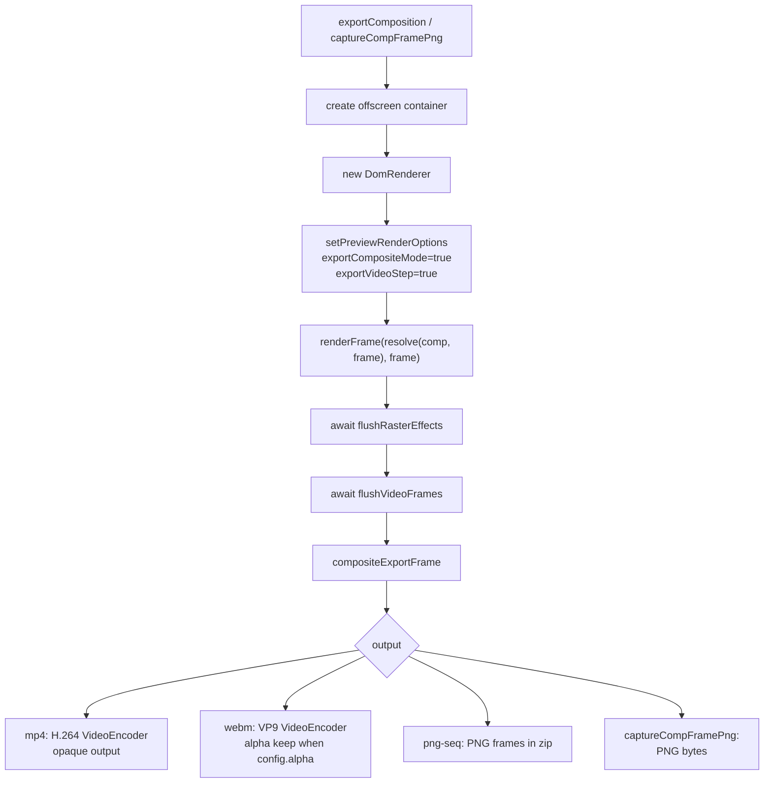
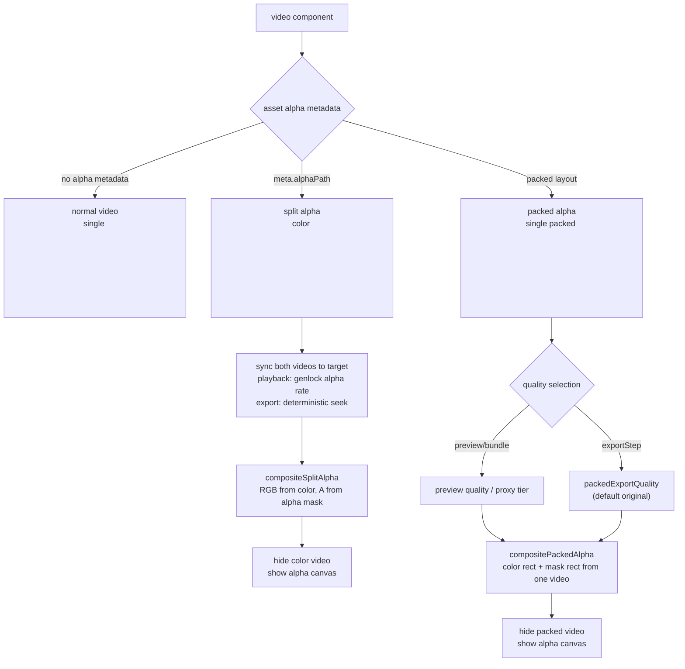

# Rendering pipeline snapshot

Date: 2026-07-08

This document maps the current runtime paths for one composition frame, with extra focus on preview playback and video assets that carry alpha. It is a snapshot of the implementation, not a new spec. The normative source remains `doc/mafter-effect-spec.md`.

## One frame, all paths

Shared invariant:

- `resolve(comp, frame)` is the shared scene-resolution kernel for preview, export, capture, and bundle.
- The main divergence is after `DomRenderer.renderFrame`: preview/bundle may use live media playback, while deterministic export/capture sets `exportVideoStep=true` and waits for media frames before rasterizing.

## Preview path

Important preview-only behavior:

- Stopped/scrub preview uses muted video elements and seeks to the same frame-center target as export.
- Playing preview sets `previewVideoPlayback=true`; video elements use native `play()` and are not re-seeked for small drift.
- The playback sync gate can hold the timeline when video is late or pause video when video is ahead.
- Video warm-up, cut-boundary element pooling, and lookahead warm-up are preview/bundle optimizations only. They are bypassed by export/capture.
- The `previewCamera` override is editor-only. Export, bundle, and nested capture do not pass it.
- RAM preview cache may replace the visible live DOM with a cached image overlay. This is a preview display optimization, not the export path.

## Export and capture path

Export/capture differences from live preview:

- `exportVideoStep=true` makes video sync use `pause()` plus deterministic seek to the frame-center target.
- `flushVideoFrames()` waits for seek/decode/present before capture, then recomposes split/packed alpha canvases.
- `compositeExportFrame()` either captures the root or uses the z-order compositor for adjustment layers, CSS blend, nested composites, or 3D-sensitive cases.
- `rasterCapture.inlineExportMedia()` replaces live canvases with PNG data and live `<video>` with still images before SVG `foreignObject` rasterization. Split/packed alpha video elements are not inlined directly; their composed canvas is inlined instead.
- mp4 is opaque. webm can preserve final-frame alpha through VP9 `alpha: "keep"` when `config.alpha` is true. PNG sequence preserves alpha per PNG when `config.alpha` is true.

## Alpha video handling

Alpha mode details:

| Mode | DOM/media shape | Preview playback | Export/capture |
| --- | --- | --- | --- |
| normal video | one visible `<video>` | native `play()` while playing; muted seek while stopped/scrubbing | deterministic seek, then inline current frame as image |
| split alpha | color `<video>` plus hidden alpha `<video>` plus canvas | both videos sync to the same target; playback uses alpha genlock rate correction when appropriate | both videos deterministic-seek; after `flushVideoFrames`, canvas is recomposited and the canvas is captured |
| packed alpha | one packed `<video>` plus canvas | one media clock, no companion/genlock; preview may use proxy quality | deterministic export can use `packedExportQuality`; canvas is recomposited before capture |

Packed alpha currently uses the `<video>` based path in `DomRenderer`. `src/runtime/packedFrameDecoder.ts` and `src/runtime/packedDemux.ts` contain a VideoDecoder-based preview decoder under development, but it is not wired into `DomRenderer` as of this snapshot.

## Path differences to watch

| Concern | Preview | Browser export / compFrameCapture | HTML bundle |
| --- | --- | --- | --- |
| Scene resolution | `resolve()` with expressions and optional editor-only `previewCamera` | `resolve()` with expressions, no preview camera override | `resolve()` inside bundled runtime, no preview camera override |
| Video time | playing uses native `play()`; scrub/stopped uses muted frame-center seek | always `exportVideoStep=true`: pause + frame-center seek + present wait | same live playback model as preview while playing |
| Video warm-up / pooling | enabled for preview playback | not used | enabled in player-style playback |
| Alpha composition | split/packed canvas is updated during render and retried when decode is not ready | `flushVideoFrames()` waits and recomposites before capture | same live canvas path as preview |
| Adjustment/blend export fidelity | live DOM/backdrop where possible | `exportCompositeMode=true`, z-order canvas compositor for export-safe capture | live bundle playback unless baked by bundle export policy |
| Final alpha | screen/stage background may show checkerboard or black behind transparent comp | mp4 opaque; webm/png-seq can preserve alpha | browser DOM transparency over host page |

## Code map

| Area | File |
| --- | --- |
| preview orchestration | `src/editor/panels/PreviewPanel.tsx` |
| shared DOM renderer and video alpha branching | `src/runtime/DomRenderer.ts` |
| video seek/play policy | `src/runtime/videoElementSync.ts` |
| split alpha composition | `src/runtime/videoSplitAlpha.ts` |
| packed alpha composition | `src/runtime/videoPackedAlpha.ts` |
| browser export | `src/runtime/exporter.ts` |
| export/capture compositor | `src/runtime/exportComposite.ts` |
| SVG foreignObject capture and media inlining | `src/runtime/rasterCapture.ts` |
| comp-frame capture / RAM/precomp raster input | `src/runtime/compFrameCapture.ts` |
| HTML bundle player | `src/player/BundlePlayer.ts` |
| packed VideoDecoder work in progress | `src/runtime/packedFrameDecoder.ts`, `src/runtime/packedDemux.ts` |
