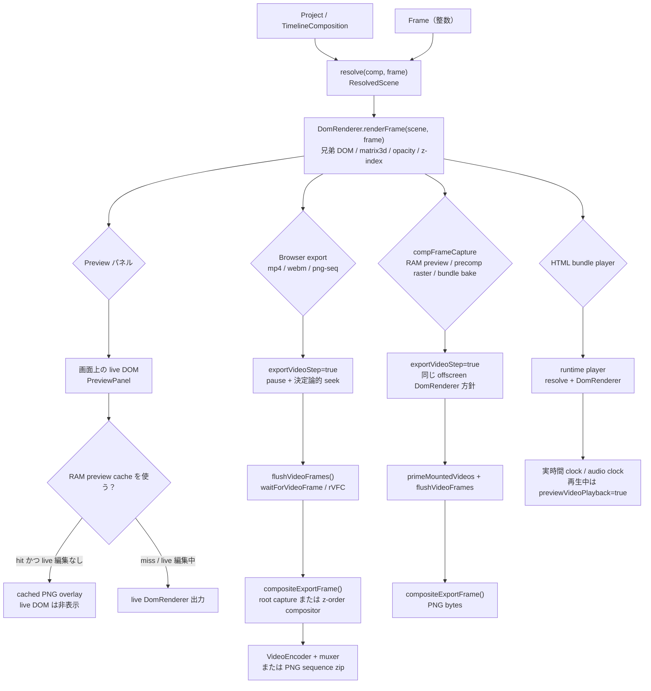
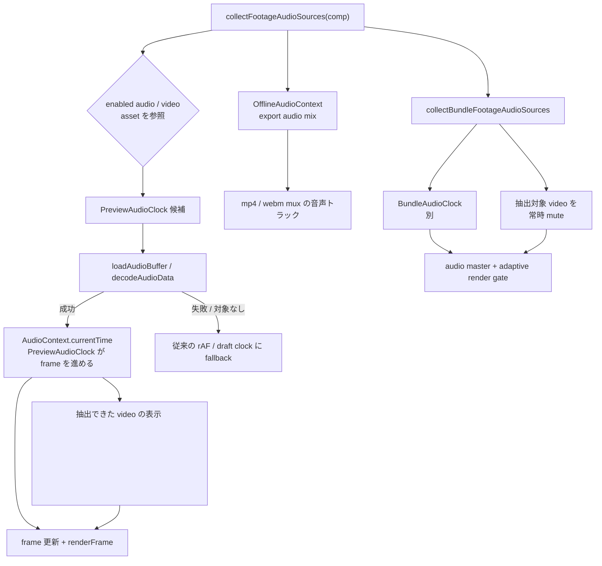
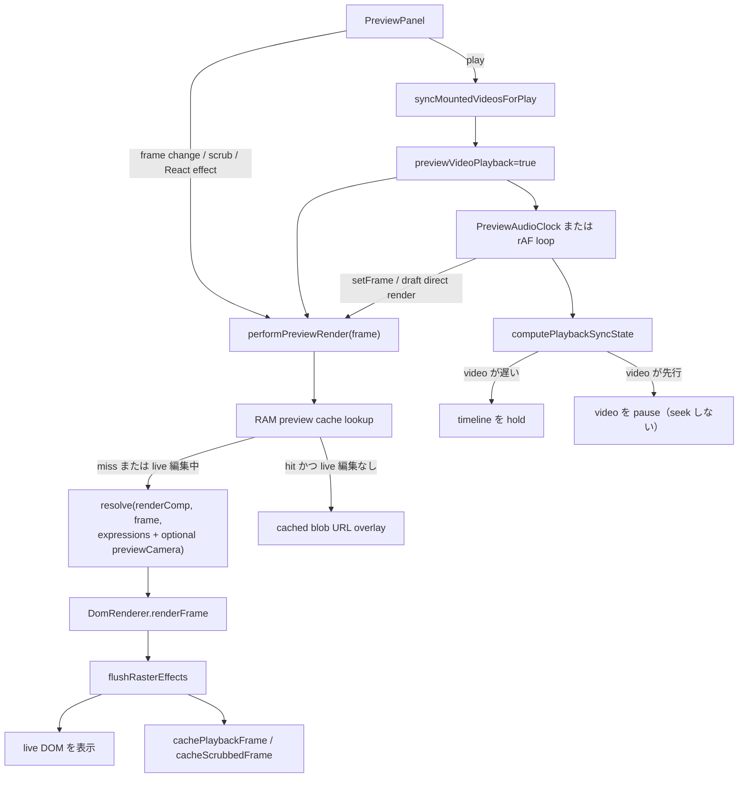
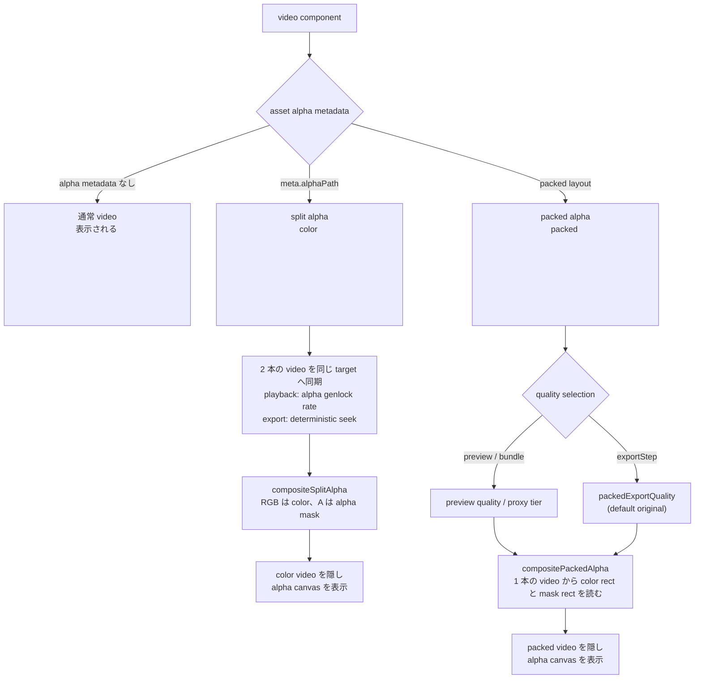

# 現在のレンダリングパイプライン

日付: 2026-07-11

この文書は、現在の実装における「1 フレームが解決され、表示または書き出されるまで」の経路を整理したスナップショットです。特に preview 再生経路、音声のクロック、alpha チャンネルを持つ動画アセットの扱いに焦点を当てています。新しい仕様を定義するものではありません。正本は引き続き `doc/mafter-effect-spec.md` です。

## 1 フレームの全体像

共有される前提:

- preview / export / capture / bundle は、scene 解決の核として同じ `resolve(comp, frame)` を使う。
- 大きな分岐は `DomRenderer.renderFrame` の後にある。preview / bundle は live media playback を使える一方、決定論的な export / capture は `exportVideoStep=true` を立て、media frame を待ってから rasterize する。

## 音声経路とクロック

音声経路の要点:

- `collectFootageAudioSources()` は enabled な `audio` と `video` の両方を対象にする。video の音声トラックが実在するかは、preview では `loadAudioBuffer()` の decode 成否で確定する。
- editor preview は、decode できた音声が 1 つでもあれば `AudioContext.currentTime` を transport clock にする。音声が無い、または decode できない場合は従来の rAF clock に戻る。
- video 内蔵音声を抽出できたレイヤーだけ `persistentlyMutedVideoIds` に入り、表示 `<video>` は常時 mute される。これにより、Web Audio 側の音声との二重再生を防ぐ。音声トラックのない video はこの集合に入らず、映像だけの通常経路になる。
- export は `OfflineAudioContext` で同じ footage 音声を frame 単位の gain automation として mix し、映像とは別に mux する。preview の Web Audio と同じ `sampleGain()` / fade suppression の純関数を共有する。
- HTML bundle は `BundleAudioClock` が別 `<audio>` 要素を管理する。音声付き video の元 `<video>` は常時 mute し、audio master で再生する。音声付き bundle の描画は adaptive render budget で中間 frame を間引けるが、音声 clock 自体は止めない。

## Preview 経路

Preview 専用の挙動:

- 停止中 / scrub 中の preview は video 要素を muted にし、export と同じ frame-center target へ seek する。
- 再生中の preview は `previewVideoPlayback=true` を立て、video 要素は native `play()` に任せる。小さな drift では毎フレーム seek しない。
- 音声が decode できた preview では、音声が正準の transport clock になる。video が遅れて `holdTimeline` が出ても `PreviewAudioClock` は suspend / resume せず、frame 進行も凍結しない。映像は一時的に古い frame の表示やコマ落ちになり得る。
- 再生同期ゲートは、video が先行していると video だけを pause できる。`holdTimeline` は映像 lag の状態として報告されるが、audio-master preview の停止理由には使わない。
- video 内蔵音声を Web Audio に抽出できたレイヤーは表示 `<video>` を持続 mute する。`audio` レイヤーは別の `AudioBufferSourceNode` として同じ clock に載る。
- video warm-up、cut-boundary の要素 pooling、lookahead warm-up は preview / bundle 専用の最適化。export / capture では使わない。
- `previewCamera` override は editor 専用。export / bundle / nested capture には渡さない。
- RAM preview cache は、表示上 live DOM を cached image overlay に差し替えることがある。これは preview 表示の最適化であり、export 経路ではない。

## Export / capture 経路

Live preview との違い:

- `exportVideoStep=true` により、video 同期は `pause()` + frame-center target への決定論的 seek になる。
- `flushVideoFrames()` は seek / decode / present を待ってから capture し、その後 split / packed alpha canvas を再合成する。
- `compositeExportFrame()` は、条件に応じて root capture か z-order compositor を使う。adjustment layer、CSS blend、nested composite、3D 文脈が絡む場合は compositor 経路に入る。
- `rasterCapture.inlineExportMedia()` は、SVG `foreignObject` rasterize の前に live canvas を PNG data に、live `<video>` を現在フレームの静止画に置き換える。split / packed alpha の video 要素は直接 inline せず、合成済み canvas を inline する。
- 音声は `OfflineAudioContext` で `audio` / video 内蔵音声を mix する。映像の `flushVideoFrames()` とは独立した音声 capture 経路で、audio の trim / gain / fade を frame 境界に合わせて mux する。
- mp4 は opaque。webm は `config.alpha` が true のとき VP9 `alpha: "keep"` で最終フレームの alpha を保持できる。PNG sequence は `config.alpha` が true のとき各 PNG が alpha を保持する。

## Alpha 付き動画の扱い

Alpha mode ごとの詳細:

| Mode | DOM / media の形 | Preview playback | Export / capture |
| --- | --- | --- | --- |
| 通常 video | 表示される `<video>` 1 本 | 再生中は native `play()`。停止 / scrub 中は muted seek | 決定論的 seek 後、現在フレームを画像として inline |
| split alpha | color `<video>` + hidden alpha `<video>` + canvas | 2 本を同じ target へ同期。必要に応じて alpha genlock rate 補正 | 2 本とも決定論的 seek。`flushVideoFrames` 後に canvas を再合成し、その canvas を capture |
| packed alpha | packed `<video>` 1 本 + canvas | media clock は 1 本だけなので companion / genlock は不要。preview は proxy quality を使える | 決定論 export では `packedExportQuality` を使える。capture 前に canvas を再合成 |

現時点の packed alpha は、`DomRenderer` 内では `<video>` ベースの経路を使っている。`src/runtime/packedFrameDecoder.ts` と `src/runtime/packedDemux.ts` には VideoDecoder ベースの preview decoder 実装があるが、このスナップショット時点では `DomRenderer` へ未配線。

## 経路差分の注意点

| 観点 | Preview | Browser export / compFrameCapture | HTML bundle |
| --- | --- | --- | --- |
| Scene resolution | expressions と editor-only `previewCamera` を渡した `resolve()` | expressions は渡すが preview camera override は渡さない | bundled runtime 内の `resolve()`。preview camera override は渡さない |
| Video time | 再生中は native `play()`。scrub / 停止中は muted frame-center seek | 常に `exportVideoStep=true`: pause + frame-center seek + present wait | 再生中は preview と同じ live playback model |
| Audio clock | 音声 decode 成功時は `PreviewAudioClock` が `AudioContext.currentTime` を正本にする。失敗時は rAF | `OfflineAudioContext` で mix。映像 frame step とは独立して mux | `BundleAudioClock` の別 `<audio>` 要素。音声 master は video lag で停止しない |
| Render cadence | 音声 clock の tick ごとに最新 frame を通知。video lag でも音声を優先 | 全 frame を決定論的に処理 | `adaptiveRenderBudget` が中間 frame を間引くが、audio clock は継続 |
| Video warm-up / pooling | preview playback で有効 | 使わない | player-style playback で有効 |
| Alpha composition | render 中に split / packed canvas を更新。decode 未完了時は retry | `flushVideoFrames()` が待機し、capture 前に再合成 | preview と同じ live canvas 経路 |
| Adjustment / blend の export fidelity | 可能な限り live DOM / backdrop | `exportCompositeMode=true`。export-safe capture のため z-order canvas compositor | bundle export policy で bake されない限り live bundle playback |
| 最終 alpha | transparent comp の背後に checkerboard や black stage が見える場合がある | mp4 は opaque。webm / png-seq は alpha 保持可能 | host page 上の browser DOM transparency |

## コード対応表

| 領域 | ファイル |
| --- | --- |
| preview orchestration | `src/editor/panels/PreviewPanel.tsx` |
| editor preview audio master | `src/editor/previewAudioClock.ts` |
| shared footage audio enumeration / gain | `src/runtime/footageAudio.ts` |
| 共通 DOM renderer と video alpha 分岐 | `src/runtime/DomRenderer.ts` |
| video seek / play 方針 | `src/runtime/videoElementSync.ts` |
| split alpha composition | `src/runtime/videoSplitAlpha.ts` |
| packed alpha composition | `src/runtime/videoPackedAlpha.ts` |
| browser export | `src/runtime/exporter.ts` |
| export / capture compositor | `src/runtime/exportComposite.ts` |
| SVG foreignObject capture と media inline | `src/runtime/rasterCapture.ts` |
| comp-frame capture / RAM / precomp raster input | `src/runtime/compFrameCapture.ts` |
| HTML bundle player | `src/player/BundlePlayer.ts` |
| bundle audio playback | `src/player/BundleAudioClock.ts`, `src/player/bundleFootageAudio.ts` |
| bundle adaptive render gate | `src/runtime/adaptiveRenderBudget.ts` |
| packed VideoDecoder 作業中実装 | `src/runtime/packedFrameDecoder.ts`, `src/runtime/packedDemux.ts` |
