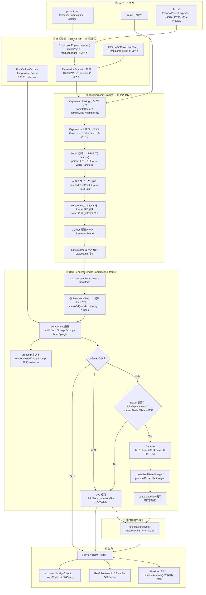

# レンダリングパイプライン（現行アーキテクチャ）

> **目的**: Mafter Effect の「1 フレームが画面に出るまで」の経路を、上から下へ追える縦図 + 解説として整理する。  
> **正**: `doc/mafter-effect-spec.md` §6–§8 / §27 / §28。実装は `@mafter/runtime`（INV-7 単一核）。  
> **更新**: 2026-06-21（§27.12 Fast\* live 化・§28 preview cache 反映）

---

## Overview

データの正は **FS 上の `project.json`**。エディタの Zustand store はその投影。  
**時間の正準は整数 `Frame`**（INV-5）。同一 frame では preview / browser export / headless export が **同じ `resolve()` 出力**を共有する（INV-2）。

レンダラは **`ResolvedScene` のみ**を受け取り、Timeline / Keyframe / SceneObject を直接参照しない（INV-3）。

---

## 縦フロー（1 フレーム）



---

## 段階別解説

### ① 入力・トリガ

| 要素 | 説明 |
|------|------|
| `TimelineComposition` | 幅・高さ・fps・duration・`objects[]`（flat list） |
| `Frame` | スクラブ・再生・export いずれも整数 frame を渡す |
| トリガ元 | **PreviewPanel**（編集 UI）、**exporter.ts**（mp4/webm/png-seq）、**BundlePlayer**（§11.7 静的 bundle）、**compFrameCapture**（precomp / 調整 capture） |

Preview は Draft 品質時は `runPreviewPlaybackLoop` が RAF で frame を進めつつ `renderFrame` を直接呼ぶ（React render をバイパス）。Best / Precise は React effect + frame clock。

---

### ② 事前準備（resolve の外）

`resolve()` は **同期・純粋**のまま保つ（INV-1）。以下は mount 前または comp 切替時に一度だけ行う:

1. **ExpressionEngine** — `scripts/<objectId>/<param>.js` を FS 経由で dynamic import
2. **HtmlCompPlayer** — HTML comp の `script.js` を Shadow DOM 隔離でロード
3. **キャッシュ** — フォントアウトライン（Best テキスト）、画像プロキシ
4. **DomRenderer 注入** — `setHtmlPlayer` / `setTimelineComps` / `setFrameRenderCache` / `setNestedCompRasterizer` 等

---

### ③ resolve(comp, frame) — シーン解決

**ファイル**: `src/runtime/resolve.ts`

```
TimelineComposition + Frame + ExpressionEvaluator?
        ↓
   ResolvedScene { width, height, objects[], camera? }
```

処理内容:

1. **アニメーション解決** — 各 `AnimatedProp` を frame でサンプリング（bezier easing）
2. **Expression** — 有効なら evaluator で上書き。失敗時はサンプル値にフォールバック（レンダリングは止めない）
3. **Transform** — `L = T(position)·R(rotation ZYX)·S(scale)·T(-anchor)`、`W = W_parent · L`
4. **可視性** — null / 調整レイヤーは components 空。通常レイヤーは components を解決
5. **Effects** — 各 effect instance の props を frame 値に解決
6. **ソート** — `zOrder` 昇順（小＝背面）。tie-break は object id
7. **Camera** — `activeCamera` の world 逆行列を `viewMatrix` として root に適用

**出力に含まれないもの**: DOM、乱数、時刻、ネットワーク。背景色は `CompositionMeta` で mount 時に DomRenderer が設定（ResolvedScene 外の静的メタ）。

---

### ④ DomRenderer — DOM 合成

**ファイル**: `src/runtime/DomRenderer.ts`  
**契約**: `Renderer` インターフェース（`renderFrame` / `mount` / `flushRasterEffects`）

#### 4a. フラット配置（§8）

- 各 `ResolvedObject` = root 直下の **兄弟** `div`（ネストしない）
- `transform: matrix3d(worldTransform)`、`transform-origin: 0 0`（anchor は行列内包）
- `opacity` は per-object（子へ CSS opacity 合成を避ける）
- `z-index = zOrder × BASE_Z`（BASE_Z = 10）

#### 4b. Component 描画

| type | 経路 |
|------|------|
| `solid` / `image` | DOM 要素を reconcile（src 変更時のみ img 再読込） |
| `text` | draft = DOM テキスト / precise = SVG アウトライン（`textRender.ts`） |
| `comp` | `renderNestedComp` — 子 comp を container 内に再帰描画（depth ≤ 4） |
| `html` | `HtmlCompPlayer` — Shadow DOM + user script |
| plugin | `globalPluginRegistry.getComponentDef().render()` |

**§28.11 precomp comp 単位キャッシュ**: displacement/raster を含む子 comp は `NestedCompRasterizer` でオフスクリーン画像化し `` 表示（preview / RAM Preview のみ。export への注入は follow-up）。

#### 4c. Effect 適用（§27）

各レイヤーで `EffectDef.apply(props, ctx)` を **配列順**に呼び、返却を分類:

```
preTokens / preSvgFilters  ←  css | svg（live）
rasterChain                ←  raster（processPixels）
postTokens / postSvgFilters ← raster 以降の live
```

**経路分岐**（`effectRouting.ts` + `pipelineAnalysis.ts` と整合）:

| 条件 | 経路 | 表示 |
|------|------|------|
| effect なし | — | 素の DOM |
| css/svg のみ（blur, tint, wipe, **Fast\*** displacement） | **Live** | `filter` または調整レイヤーは `backdrop-filter` |
| `wave` / `ripple` / `turbulentDisplace`（full） | **Raster capture** | 自己コンテンツ clone → filter 適用 → canvas overlay |
| `pixelSorter` 等 `processPixels` | **Raster chain** | buffer 上で逐次処理 |
| Live 調整 + displacement または export `auto_raster_mp4` | **Raster capture** | comp 背面（zOrder より下）を DOM capture → filter → overlay |
| Raster 調整（`adjustmentMode: "raster"`） | **Raster capture** | live effect も含め背面 capture で焼く |

**確定境界**: raster 出力は以降の live 計算から切り離される（§27.4.1）。Pipeline パネルが `live→raster→live` の「崖」を検出。

**§28.10 per-layer cache**: capture キーは comp 絶対 frame ではなく **layer-local frame**（`frame - inPoint`）。レイヤーをスライドしても内容不変なら再ラスタしない。

---

### ⑤ flushRasterEffects

`applyEffects` 内の raster は **非同期**（`captureElementToCanvas` / worker）。  
export と preview parity のため、各 frame 描画後に `await flushRasterEffects()` で `rasterPending` を待つ。

Preview の `holdLastRaster`（§27.12）: 次 frame の capture 完了まで前 frame の canvas を保持し flicker を抑える。

---

### ⑥ 出力先の違い

| 経路 | resolve | DomRenderer オプション | 追加 |
|------|---------|------------------------|------|
| **Preview（live）** | 同一 | 既定。Live 調整 = backdrop-filter | RAM Preview cache（L1 メモリ + L2 IDB）、Auto Preview Cache（full displacement comp のみ） |
| **Export mp4/png** | 同一 | `forceAdjustmentRaster: true`（Live 調整を capture 化） | root を foreignObject でラスタ → WebCodecs / PNG-seq |
| **Web Bundle Player** | 同一（bundle 内 project） | preview 同等 | 実時間再生（INV-8: マスタークロックは音声） |

---

## 横断的な設計原則

| ID | 内容 |
|----|------|
| INV-1 | `resolve()` は純関数。乱数は seeded helper のみ |
| INV-2 | 同一 frame の scene 解決値は preview / export / bundle で一致 |
| INV-3 | Renderer は `ResolvedScene` のみ。Timeline は非依存 |
| INV-7 | preview / exporter / player が `@mafter/runtime` を共有 |

---

## 関連ファイル（クイックリファレンス）

| 役割 | パス |
|------|------|
| シーン解決 | `src/runtime/resolve.ts` |
| DOM レンダラ | `src/runtime/DomRenderer.ts` |
| Effect 経路 SSOT | `src/runtime/effectRouting.ts` |
| Pipeline 可視化（純関数） | `src/editor/pipelineAnalysis.ts` |
| SVG filter 生成 | `src/runtime/effectSvg.ts` |
| DOM→canvas capture | `src/runtime/rasterCapture.ts` |
| Preview 統合 | `src/editor/panels/PreviewPanel.tsx` |
| Export | `src/runtime/exporter.ts` |
| precomp capture | `src/runtime/compFrameCapture.ts` |

---

## 既知の境界（follow-up）

- export / bundle への **precomp comp 単位 rasterizer** 未配線（ネスト comp 内 effect は Phase-1 非焼き込みのまま）
- SVG 5 種（wave/ripple/turbulent/wipe）の preview↔export ピクセル parity 未検証
- `pipelineAnalysis` と DomRenderer の判定は共有 SSOT だが、実際の multi-pass flush の export 厳密 sequential 化は follow-up
